# 游戏内素材索引

本文件由 `tools/canvas/extract_game_assets.py` 依据仓库实际文件与各素材自带的清单生成，只登记 `assets/` 下游戏运行时真实读取的素材；不复制、不移动、不改写原始文件。

画板：`Untitled`。共 212 个已登记素材。

## 排除说明

- `assets/skill_art_exports/`：其 `catalog.json` 自述 `binding_status: unbound`，游戏代码未引用，故不进画布。
- `build/libtv/` 下的抠像与生成实验候选：当前游戏未引用，按项目约定不作为生产素材登记。
- 各目录的 `*.import`、Blender `source/` 源文件与验收记录：不作为运行时素材登记。

## 主角七形态逐帧

六身份七形态的高清逐帧动画原图。每个形态取待机首帧、攻击首帧、倒地单帧三张，帧号与时长以各形态 manifest.json 为准；同目录 atlases/ 是运行时合成的图集。

### 凛音·待机首帧（对话半身取景来源）

`assets/chars/pixel/rinne/high_detail_complete/frames/idle1.png`

生产素材｜游戏内实际读取。
身份 凛音（rinne），形态 rinne。
角色：待机首帧（对话半身取景来源）；动作清单见 assets/chars/pixel/rinne/high_detail_complete/manifest.json 的 anims.idle。
逐帧画布 1344×1152，脚锚 [672, 1083]，身高标尺 1.68 m；动作图集在同级 atlases/ 下。
本帧像素 1344×1152，669 KB。

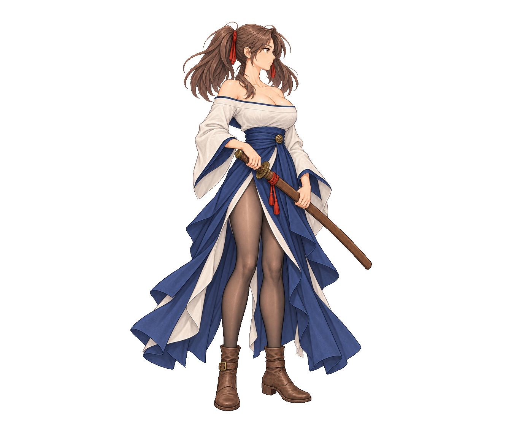

### 凛音·攻击动作首帧

`assets/chars/pixel/rinne/high_detail_complete/frames/attack1.png`

生产素材｜游戏内实际读取。
身份 凛音（rinne），形态 rinne。
角色：攻击动作首帧；动作清单见 assets/chars/pixel/rinne/high_detail_complete/manifest.json 的 anims.attack。
逐帧画布 1344×1152，脚锚 [672, 1083]，身高标尺 1.68 m；动作图集在同级 atlases/ 下。
本帧像素 1344×1152，722 KB。

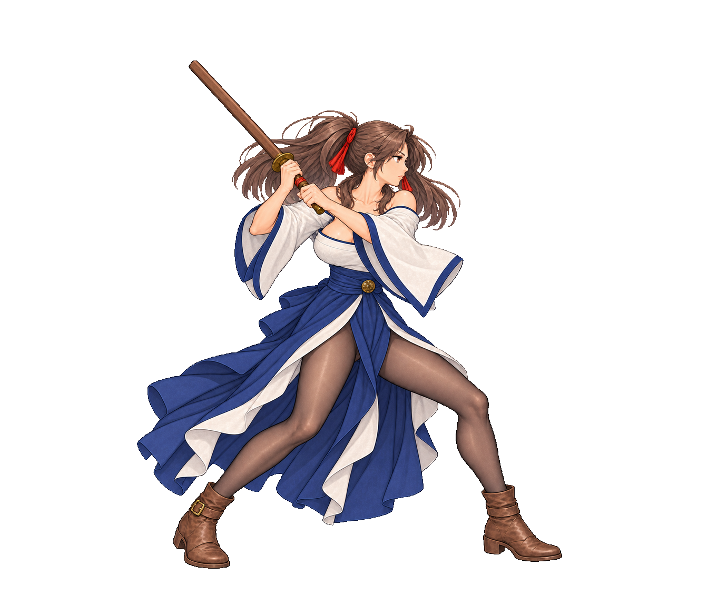

### 凛音·倒地单帧

`assets/chars/pixel/rinne/high_detail_complete/frames/down.png`

生产素材｜游戏内实际读取。
身份 凛音（rinne），形态 rinne。
角色：倒地单帧；动作清单见 assets/chars/pixel/rinne/high_detail_complete/manifest.json 的 anims.down。
逐帧画布 1344×1152，脚锚 [672, 1083]，身高标尺 1.68 m；动作图集在同级 atlases/ 下。
本帧像素 1344×1152，482 KB。

### 焰华·剑形态·待机首帧（对话半身取景来源）

`assets/chars/pixel/homura_sword/high_detail_complete/frames/idle1.png`

生产素材｜游戏内实际读取。
身份 焰华·剑形态（homura），形态 homura_sword。
角色：待机首帧（对话半身取景来源）；动作清单见 assets/chars/pixel/homura_sword/high_detail_complete/manifest.json 的 anims.idle。
逐帧画布 1600×1152，脚锚 [800, 1067]，身高标尺 1.6 m；动作图集在同级 atlases/ 下。
本帧像素 1600×1152，623 KB。

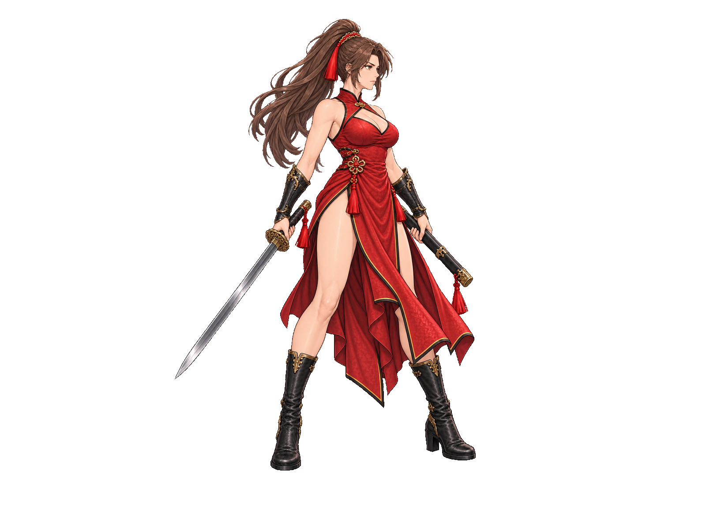

### 焰华·剑形态·攻击动作首帧

`assets/chars/pixel/homura_sword/high_detail_complete/frames/attack1.png`

生产素材｜游戏内实际读取。
身份 焰华·剑形态（homura），形态 homura_sword。
角色：攻击动作首帧；动作清单见 assets/chars/pixel/homura_sword/high_detail_complete/manifest.json 的 anims.attack。
逐帧画布 1600×1152，脚锚 [800, 1067]，身高标尺 1.6 m；动作图集在同级 atlases/ 下。
本帧像素 1600×1152，628 KB。

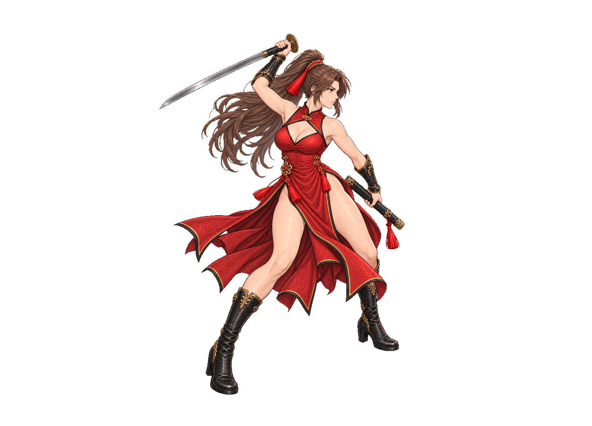

### 焰华·剑形态·倒地单帧

`assets/chars/pixel/homura_sword/high_detail_complete/frames/down.png`

生产素材｜游戏内实际读取。
身份 焰华·剑形态（homura），形态 homura_sword。
角色：倒地单帧；动作清单见 assets/chars/pixel/homura_sword/high_detail_complete/manifest.json 的 anims.down。
逐帧画布 1600×1152，脚锚 [800, 1067]，身高标尺 1.6 m；动作图集在同级 atlases/ 下。
本帧像素 1600×1152，610 KB。

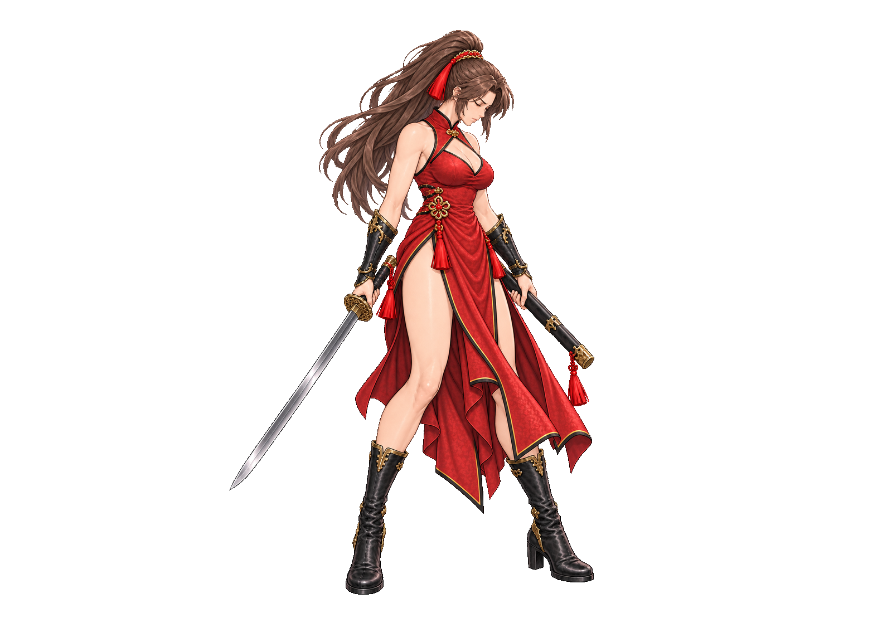

### 焰华·法师形态·待机首帧（对话半身取景来源）

`assets/chars/pixel/homura_mage/high_detail_complete/frames/idle1.png`

生产素材｜游戏内实际读取。
身份 焰华·法师形态（homura），形态 homura_mage。
角色：待机首帧（对话半身取景来源）；动作清单见 assets/chars/pixel/homura_mage/high_detail_complete/manifest.json 的 anims.idle。
逐帧画布 1024×1088，脚锚 [512, 1055]，身高标尺 1.6 m；动作图集在同级 atlases/ 下。
本帧像素 1024×1088，658 KB。

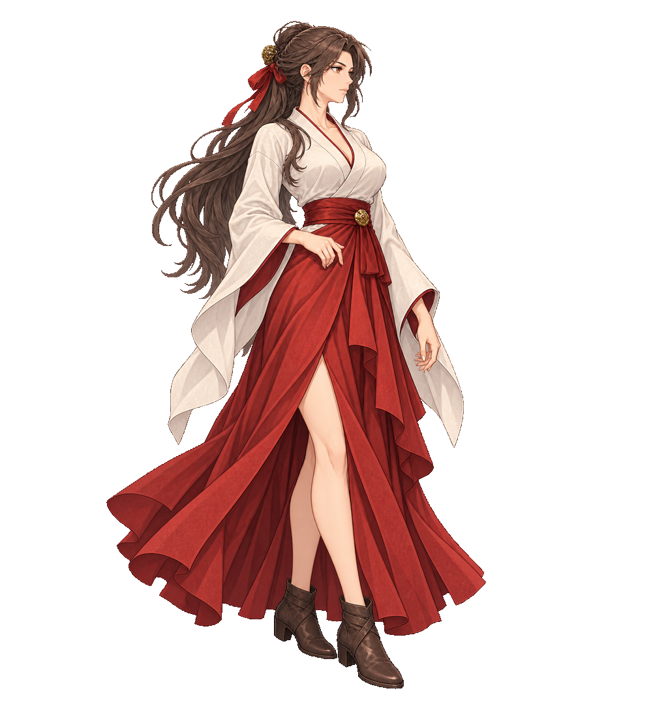

### 焰华·法师形态·攻击动作首帧

`assets/chars/pixel/homura_mage/high_detail_complete/frames/attack1.png`

生产素材｜游戏内实际读取。
身份 焰华·法师形态（homura），形态 homura_mage。
角色：攻击动作首帧；动作清单见 assets/chars/pixel/homura_mage/high_detail_complete/manifest.json 的 anims.attack。
逐帧画布 1024×1088，脚锚 [512, 1055]，身高标尺 1.6 m；动作图集在同级 atlases/ 下。
本帧像素 1024×1088，806 KB。

### 焰华·法师形态·倒地单帧

`assets/chars/pixel/homura_mage/high_detail_complete/frames/down.png`

生产素材｜游戏内实际读取。
身份 焰华·法师形态（homura），形态 homura_mage。
角色：倒地单帧；动作清单见 assets/chars/pixel/homura_mage/high_detail_complete/manifest.json 的 anims.down。
逐帧画布 1024×1088，脚锚 [512, 1055]，身高标尺 1.6 m；动作图集在同级 atlases/ 下。
本帧像素 1024×1088，602 KB。

### 薄荷·待机首帧（对话半身取景来源）

`assets/chars/pixel/mint/high_detail_complete/frames/idle_right_f1.png`

生产素材｜游戏内实际读取。
身份 薄荷（mint），形态 mint。
角色：待机首帧（对话半身取景来源）；动作清单见 assets/chars/pixel/mint/high_detail_complete/manifest.json 的 anims.idle。
逐帧画布 1280×1152，脚锚 [640, 1062]，身高标尺 1.6 m；动作图集在同级 atlases/ 下。
本帧像素 1280×1152，477 KB。

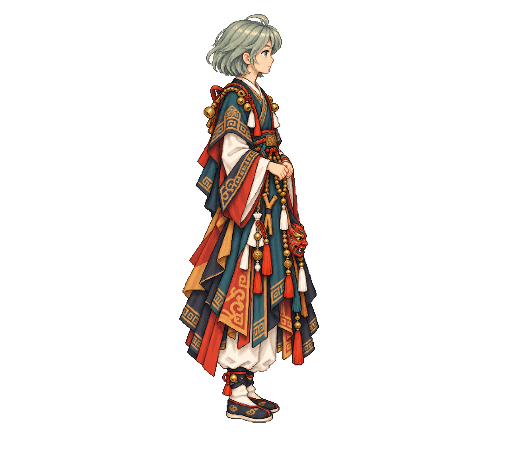

### 薄荷·攻击动作首帧

`assets/chars/pixel/mint/high_detail_complete/frames/attack_right_f1.png`

生产素材｜游戏内实际读取。
身份 薄荷（mint），形态 mint。
角色：攻击动作首帧；动作清单见 assets/chars/pixel/mint/high_detail_complete/manifest.json 的 anims.attack。
逐帧画布 1280×1152，脚锚 [640, 1062]，身高标尺 1.6 m；动作图集在同级 atlases/ 下。
本帧像素 1280×1152，849 KB。

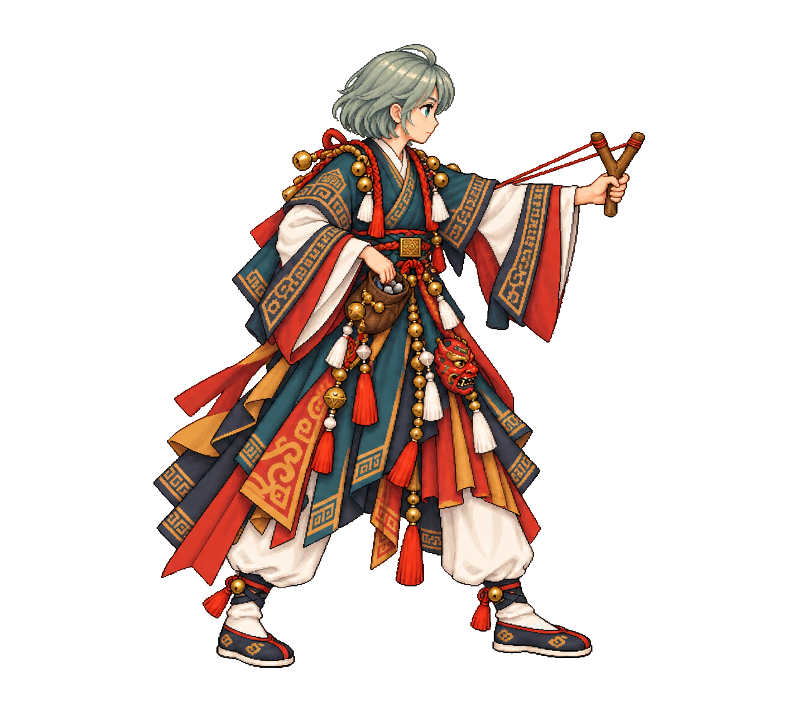

### 薄荷·倒地单帧

`assets/chars/pixel/mint/high_detail_complete/frames/down_right_f1.png`

生产素材｜游戏内实际读取。
身份 薄荷（mint），形态 mint。
角色：倒地单帧；动作清单见 assets/chars/pixel/mint/high_detail_complete/manifest.json 的 anims.down。
逐帧画布 1280×1152，脚锚 [640, 1062]，身高标尺 1.6 m；动作图集在同级 atlases/ 下。
本帧像素 1280×1152，540 KB。

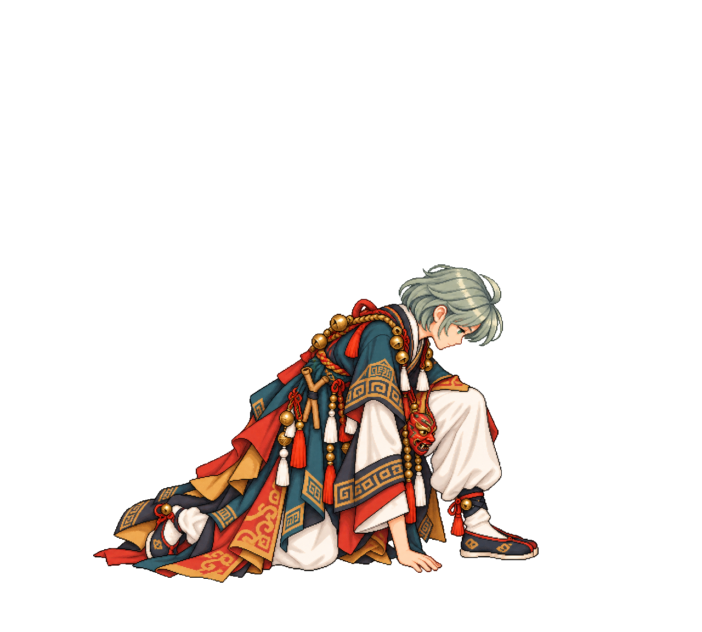

### 岑照·待机首帧（对话半身取景来源）

`assets/chars/pixel/guard/high_detail_complete/frames/idle1.png`

生产素材｜游戏内实际读取。
身份 岑照（guard），形态 guard。
角色：待机首帧（对话半身取景来源）；动作清单见 assets/chars/pixel/guard/high_detail_complete/manifest.json 的 anims.idle。
逐帧画布 1216×1216，脚锚 [608, 1123]，身高标尺 1.86 m；动作图集在同级 atlases/ 下。
本帧像素 1216×1216，1016 KB。

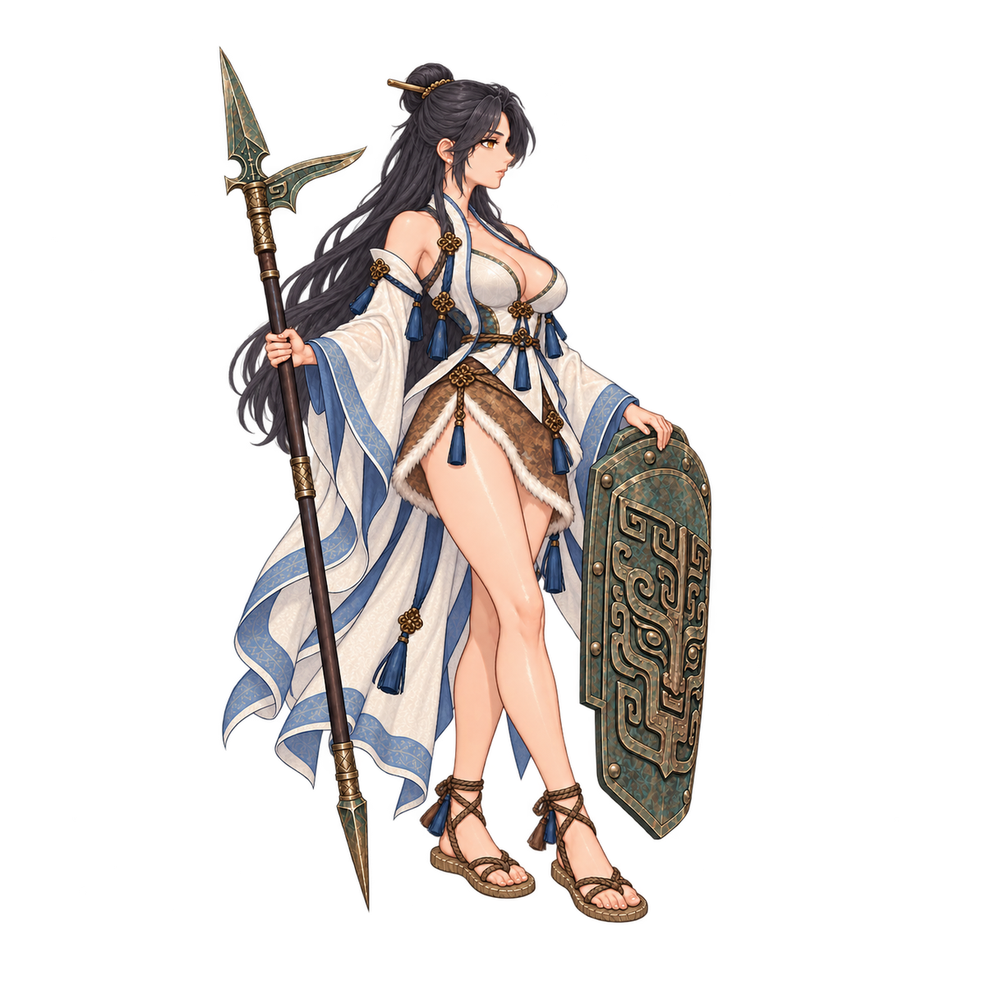

### 岑照·攻击动作首帧

`assets/chars/pixel/guard/high_detail_complete/frames/attack1.png`

生产素材｜游戏内实际读取。
身份 岑照（guard），形态 guard。
角色：攻击动作首帧；动作清单见 assets/chars/pixel/guard/high_detail_complete/manifest.json 的 anims.attack。
逐帧画布 1216×1216，脚锚 [608, 1123]，身高标尺 1.86 m；动作图集在同级 atlases/ 下。
本帧像素 1216×1216，1.0 MB。

### 岑照·倒地单帧

`assets/chars/pixel/guard/high_detail_complete/frames/down.png`

生产素材｜游戏内实际读取。
身份 岑照（guard），形态 guard。
角色：倒地单帧；动作清单见 assets/chars/pixel/guard/high_detail_complete/manifest.json 的 anims.down。
逐帧画布 1216×1216，脚锚 [608, 1123]，身高标尺 1.86 m；动作图集在同级 atlases/ 下。
本帧像素 1216×1216，717 KB。

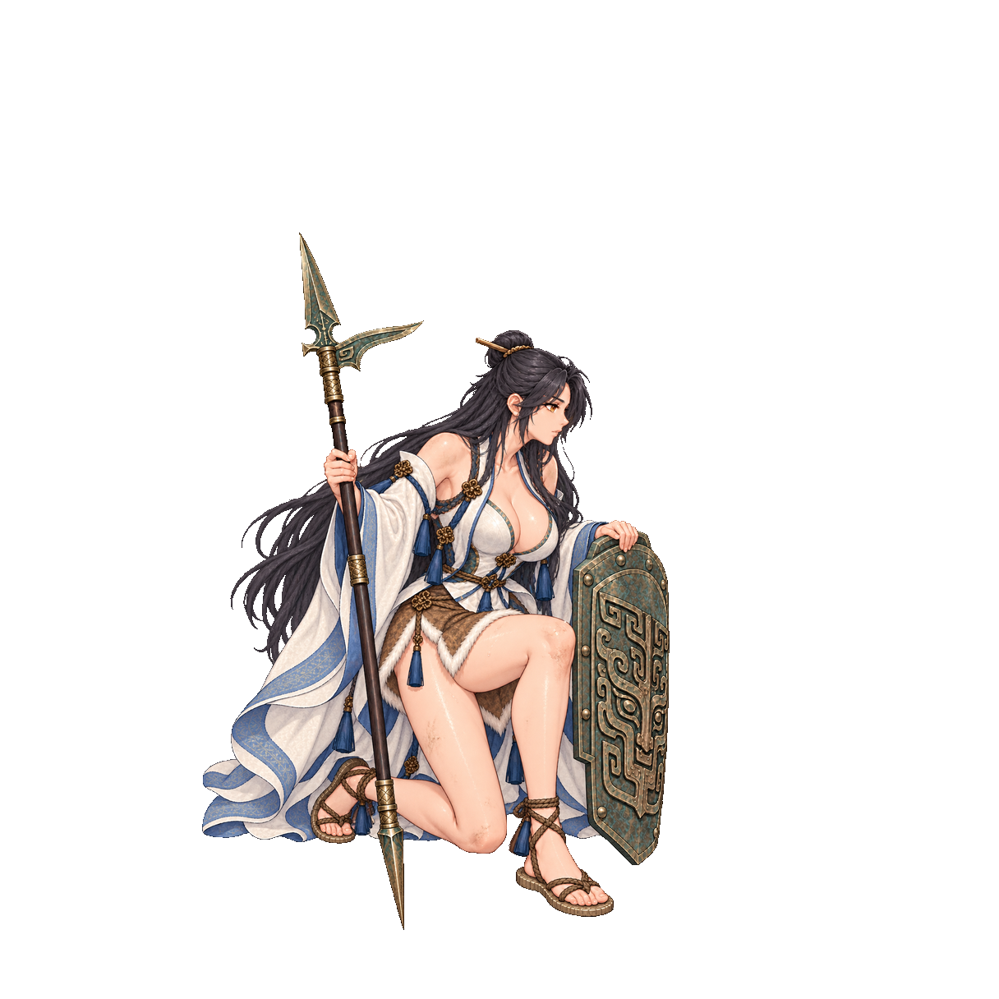

### 苏合·待机首帧（对话半身取景来源）

`assets/chars/pixel/healer/high_detail_complete/frames/idle1.png`

生产素材｜游戏内实际读取。
身份 苏合（healer），形态 healer。
角色：待机首帧（对话半身取景来源）；动作清单见 assets/chars/pixel/healer/high_detail_complete/manifest.json 的 anims.idle。
逐帧画布 1088×1152，脚锚 [544, 1072]，身高标尺 1.6 m；动作图集在同级 atlases/ 下。
本帧像素 1088×1152，655 KB。

### 苏合·攻击动作首帧

`assets/chars/pixel/healer/high_detail_complete/frames/attack1.png`

生产素材｜游戏内实际读取。
身份 苏合（healer），形态 healer。
角色：攻击动作首帧；动作清单见 assets/chars/pixel/healer/high_detail_complete/manifest.json 的 anims.attack。
逐帧画布 1088×1152，脚锚 [544, 1072]，身高标尺 1.6 m；动作图集在同级 atlases/ 下。
本帧像素 1088×1152，773 KB。

### 苏合·倒地单帧

`assets/chars/pixel/healer/high_detail_complete/frames/down.png`

生产素材｜游戏内实际读取。
身份 苏合（healer），形态 healer。
角色：倒地单帧；动作清单见 assets/chars/pixel/healer/high_detail_complete/manifest.json 的 anims.down。
逐帧画布 1088×1152，脚锚 [544, 1072]，身高标尺 1.6 m；动作图集在同级 atlases/ 下。
本帧像素 1088×1152，657 KB。

### 清明·待机首帧（对话半身取景来源）

`assets/chars/pixel/controller/high_detail_complete/frames/idle1.png`

生产素材｜游戏内实际读取。
身份 清明（controller），形态 controller。
角色：待机首帧（对话半身取景来源）；动作清单见 assets/chars/pixel/controller/high_detail_complete/manifest.json 的 anims.idle。
逐帧画布 1152×1152，脚锚 [576, 1074]，身高标尺 1.6 m；动作图集在同级 atlases/ 下。
本帧像素 1152×1152，672 KB。

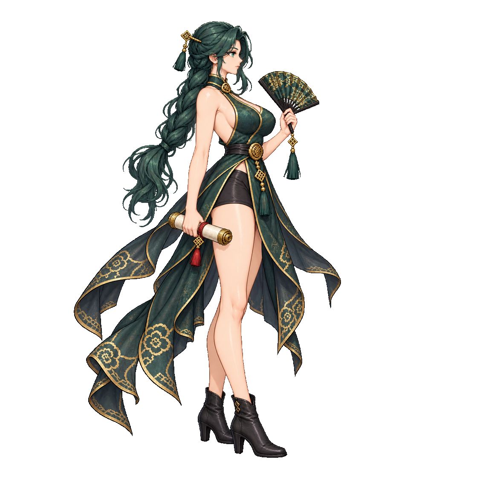

### 清明·攻击动作首帧

`assets/chars/pixel/controller/high_detail_complete/frames/attack1.png`

生产素材｜游戏内实际读取。
身份 清明（controller），形态 controller。
角色：攻击动作首帧；动作清单见 assets/chars/pixel/controller/high_detail_complete/manifest.json 的 anims.attack。
逐帧画布 1152×1152，脚锚 [576, 1074]，身高标尺 1.6 m；动作图集在同级 atlases/ 下。
本帧像素 1152×1152，701 KB。

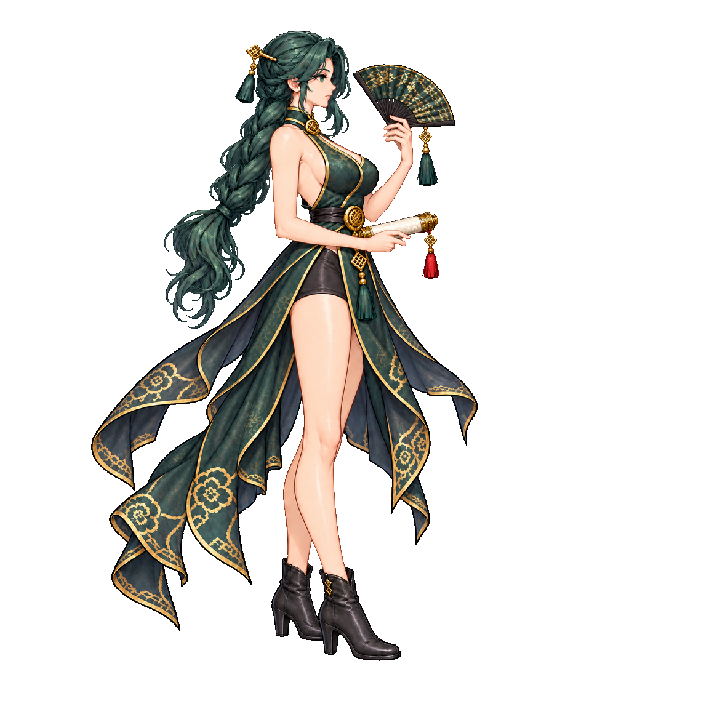

### 清明·倒地单帧

`assets/chars/pixel/controller/high_detail_complete/frames/down.png`

生产素材｜游戏内实际读取。
身份 清明（controller），形态 controller。
角色：倒地单帧；动作清单见 assets/chars/pixel/controller/high_detail_complete/manifest.json 的 anims.down。
逐帧画布 1152×1152，脚锚 [576, 1074]，身高标尺 1.6 m；动作图集在同级 atlases/ 下。
本帧像素 1152×1152，629 KB。

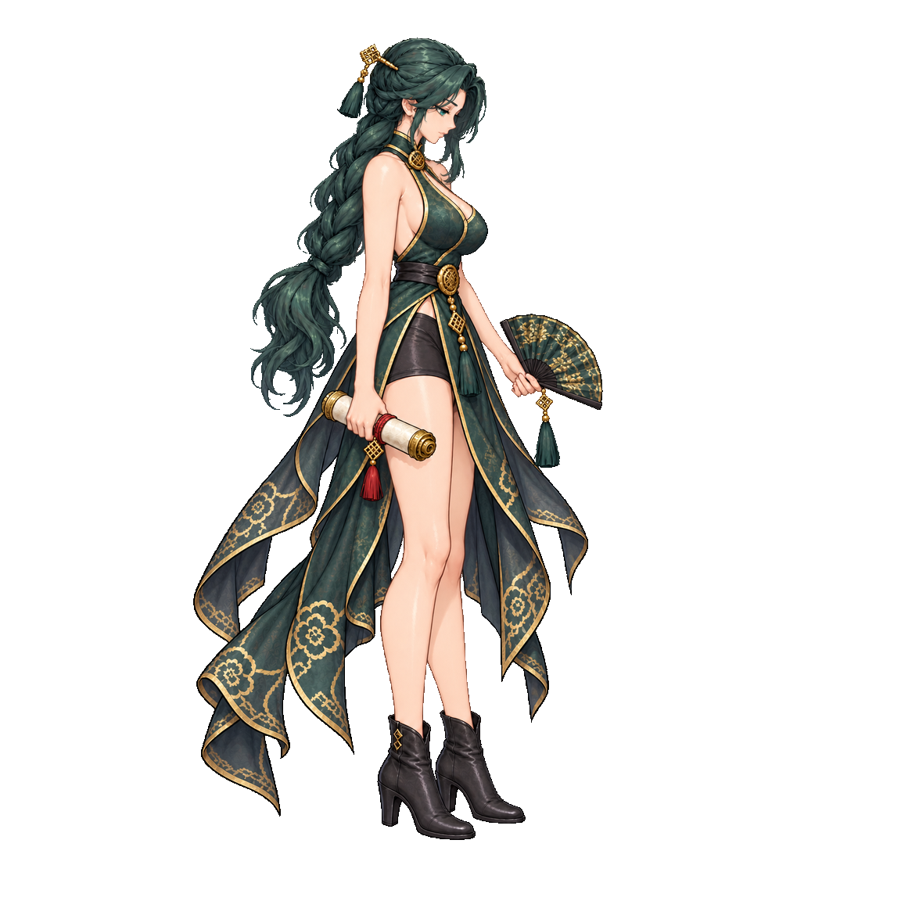

## 第一章敌方原图

六张已批准的最终静态敌方图，RGBA 透明底、朝右，战斗与地图共用同一批字节。

### 第一章敌方·纸妖·疾行

`assets/chars/enemies/current/hound.png`

生产素材｜游戏内实际读取的第一章敌方原图（approved static art）。
纸妖·疾行，敌人ID hound，朝向 right。
1024×1536 RGBA，透明像素 839280；来源与哈希见 assets/chars/enemies/current/asset_manifest.json（sha256 前16位 19e3c8da9e1b9e79）。
实际提示词：hound/纸妖_疾行_完整实际提示词.txt。

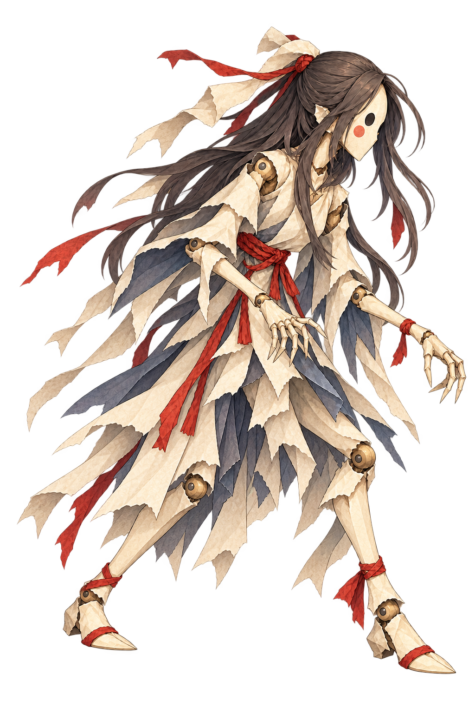

### 第一章敌方·纸妖·守盾

`assets/chars/enemies/current/shield_soldier.png`

生产素材｜游戏内实际读取的第一章敌方原图（approved static art）。
纸妖·守盾，敌人ID shield_soldier，朝向 right。
1024×1536 RGBA，透明像素 765643；来源与哈希见 assets/chars/enemies/current/asset_manifest.json（sha256 前16位 1339c65fa163550b）。
实际提示词：shield_soldier/shield_soldier_actual_prompts.txt。

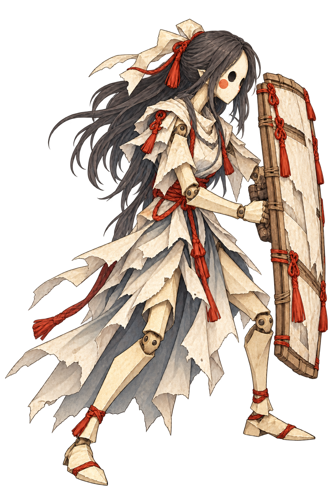

### 第一章敌方·纸妖·炎灵

`assets/chars/enemies/current/fire_spirit.png`

生产素材｜游戏内实际读取的第一章敌方原图（approved static art）。
纸妖·炎灵，敌人ID fire_spirit，朝向 right。
1024×1536 RGBA，透明像素 900658；来源与哈希见 assets/chars/enemies/current/asset_manifest.json（sha256 前16位 18d735e30df7a86e）。
实际提示词：fire_spirit/fire_spirit_full_prompts.txt。

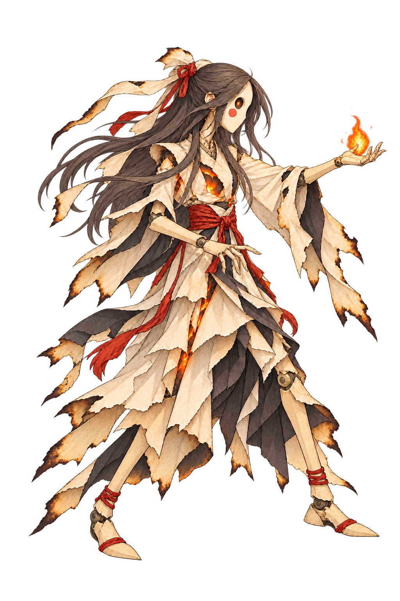

### 第一章敌方·纸妖·咒术

`assets/chars/enemies/current/cultist.png`

生产素材｜游戏内实际读取的第一章敌方原图（approved static art）。
纸妖·咒术，敌人ID cultist，朝向 right。
1024×1536 RGBA，透明像素 909218；来源与哈希见 assets/chars/enemies/current/asset_manifest.json（sha256 前16位 e385bbac0b89cc43）。
实际提示词：cultist/cultist_full_prompts.txt。

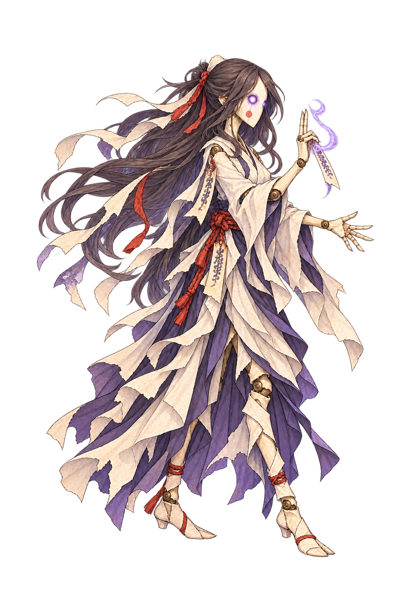

### 第一章敌方·纸妖·精锐守盾

`assets/chars/enemies/current/elite_shield_soldier.png`

生产素材｜游戏内实际读取的第一章敌方原图（approved static art）。
纸妖·精锐守盾，敌人ID elite_shield_soldier，朝向 right。
1024×1536 RGBA，透明像素 705676；来源与哈希见 assets/chars/enemies/current/asset_manifest.json（sha256 前16位 7ab602d1a2122e66）。
实际提示词：elite_shield_soldier/elite_shield_soldier_actual_prompts.txt。

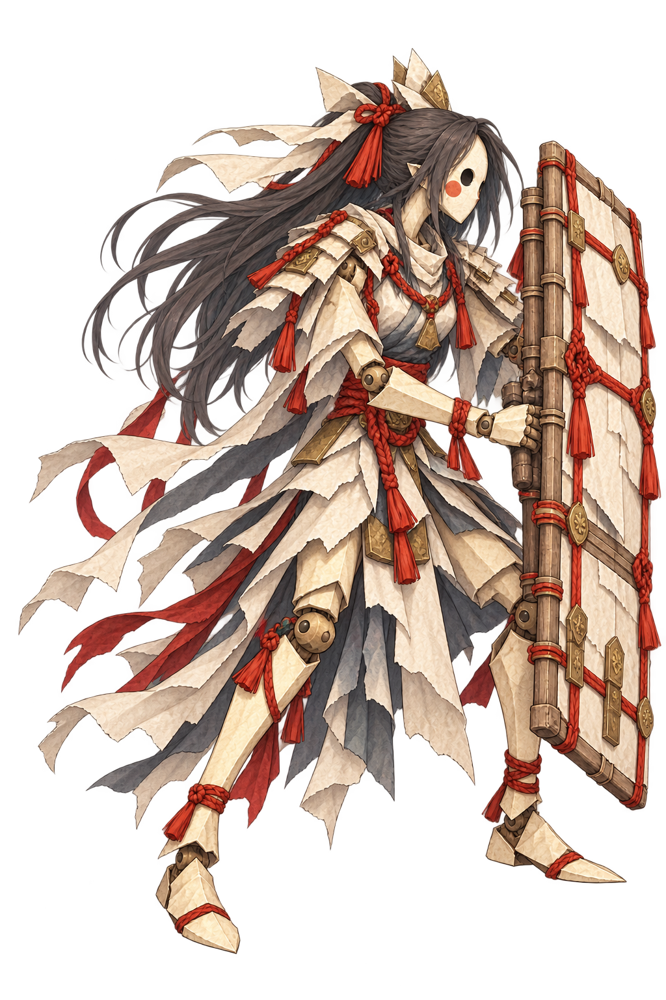

### 第一章敌方·棺守

`assets/chars/enemies/current/gatekeeper.png`

生产素材｜游戏内实际读取的第一章敌方原图（approved static art）。
棺守，敌人ID gatekeeper，朝向 right。
1024×1536 RGBA，透明像素 695720；来源与哈希见 assets/chars/enemies/current/asset_manifest.json（sha256 前16位 3319142b7b7b8278）。
实际提示词：gatekeeper/棺守_实际生成提示词.txt。

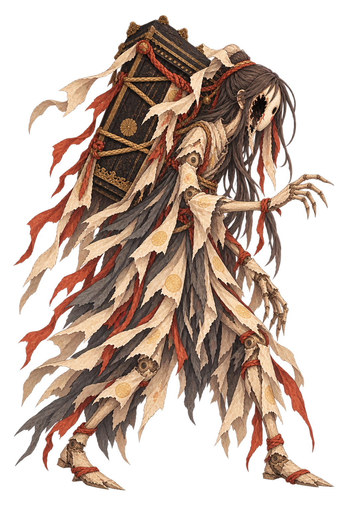

## 后六章敌方图集

八张图集，每张承载一到两个敌种；运行时按 asset_manifest.json 的 region/anchor 局部取用，不整张拉伸。

### 后六章敌方·出口·堵门反冲／中段·分流残响

`assets/chars/enemies/saga/exit_relay.png`

生产素材｜游戏内实际读取的后六章敌方图集。
同一张图集内按 region 切出 2 个敌种：出口·堵门反冲／中段·分流残响。
切分区域与脚锚：出口·堵门反冲=[0, 0, 887, 887]；中段·分流残响=[887, 0, 887, 887]。
图集像素 1774×887；登记来源见 assets/chars/enemies/saga/asset_manifest.json。

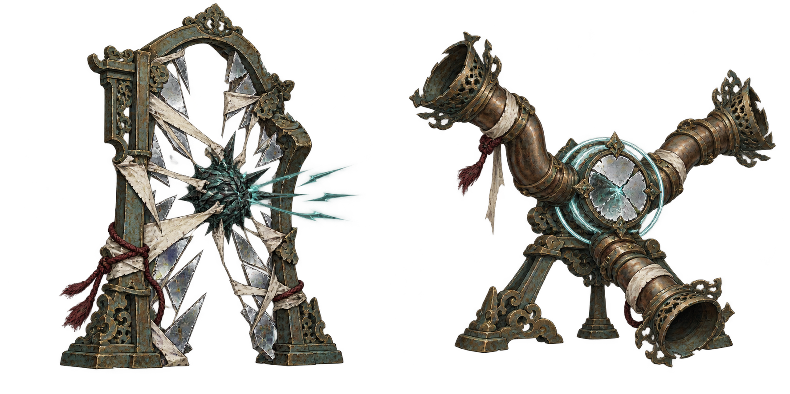

### 后六章敌方·主镜·最后余压

`assets/chars/enemies/saga/final_recoil.png`

生产素材｜游戏内实际读取的后六章敌方图集。
同一张图集内按 region 切出 1 个敌种：主镜·最后余压。
切分区域与脚锚：主镜·最后余压=[0, 0, 1312, 1199]。
图集像素 1312×1199；登记来源见 assets/chars/enemies/saga/asset_manifest.json。

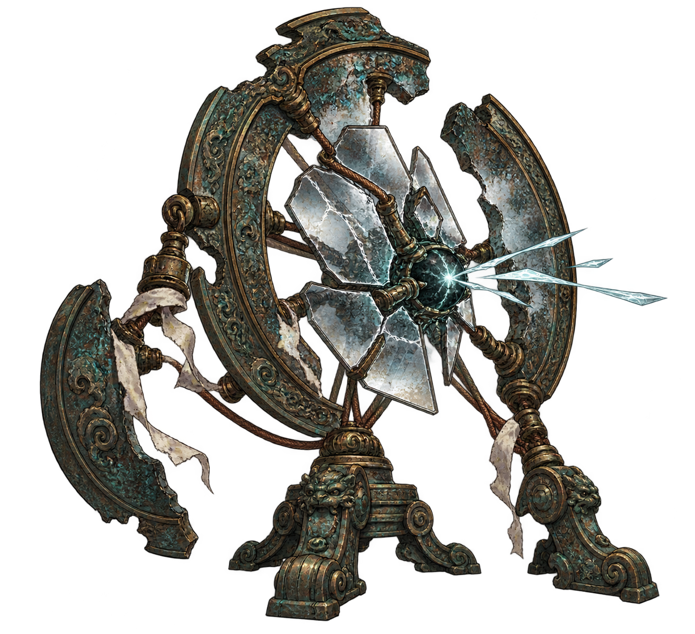

### 后六章敌方·左联动锁片／右联动锁片

`assets/chars/enemies/saga/linked_anchors.png`

生产素材｜游戏内实际读取的后六章敌方图集。
同一张图集内按 region 切出 2 个敌种：左联动锁片／右联动锁片。
切分区域与脚锚：左联动锁片=[0, 0, 940, 836]；右联动锁片=[940, 0, 941, 836]。
图集像素 1881×836；登记来源见 assets/chars/enemies/saga/asset_manifest.json。

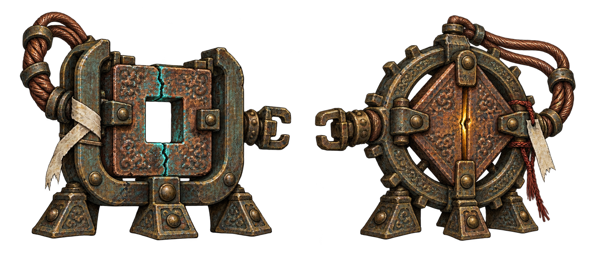

### 后六章敌方·合面镜／百手灯母

`assets/chars/enemies/saga/mirror_lamp.png`

生产素材｜游戏内实际读取的后六章敌方图集。
同一张图集内按 region 切出 2 个敌种：合面镜／百手灯母。
切分区域与脚锚：合面镜=[0, 0, 887, 887]；百手灯母=[887, 0, 887, 887]。
图集像素 1774×887；登记来源见 assets/chars/enemies/saga/asset_manifest.json。

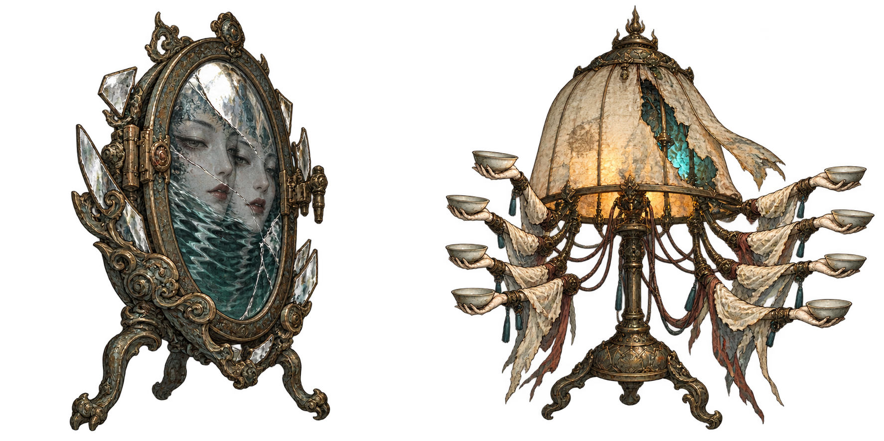

### 后六章敌方·镜屑侍／沈烛舟·执灯纸躯

`assets/chars/enemies/saga/shard_bearer.png`

生产素材｜游戏内实际读取的后六章敌方图集。
同一张图集内按 region 切出 2 个敌种：镜屑侍／沈烛舟·执灯纸躯。
切分区域与脚锚：镜屑侍=[0, 0, 887, 887]；沈烛舟·执灯纸躯=[887, 0, 887, 887]。
图集像素 1774×887；登记来源见 assets/chars/enemies/saga/asset_manifest.json。

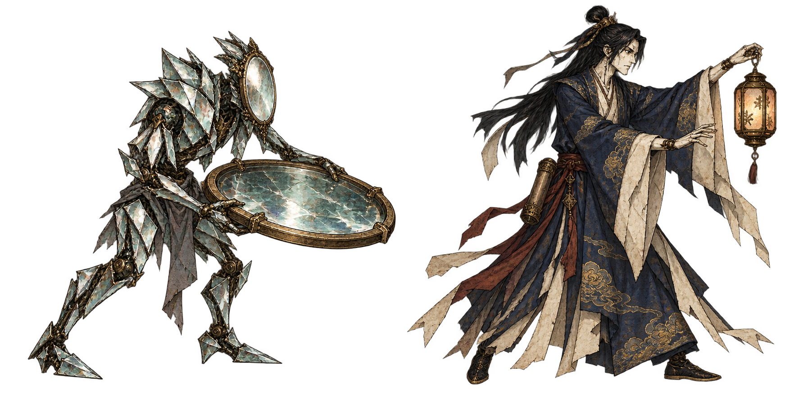

### 后六章敌方·循令纸兵／纸灯残影

`assets/chars/enemies/saga/soldier_shadow.png`

生产素材｜游戏内实际读取的后六章敌方图集。
同一张图集内按 region 切出 2 个敌种：循令纸兵／纸灯残影。
切分区域与脚锚：循令纸兵=[0, 0, 887, 887]；纸灯残影=[887, 0, 887, 887]。
图集像素 1774×887；登记来源见 assets/chars/enemies/saga/asset_manifest.json。

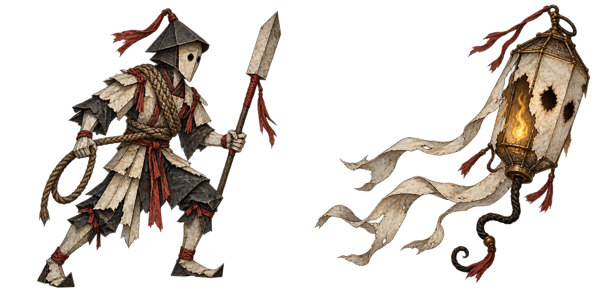

### 后六章敌方·借声客／背岸将

`assets/chars/enemies/saga/voice_general.png`

生产素材｜游戏内实际读取的后六章敌方图集。
同一张图集内按 region 切出 2 个敌种：借声客／背岸将。
切分区域与脚锚：借声客=[0, 0, 887, 887]；背岸将=[887, 0, 887, 887]。
图集像素 1774×887；登记来源见 assets/chars/enemies/saga/asset_manifest.json。

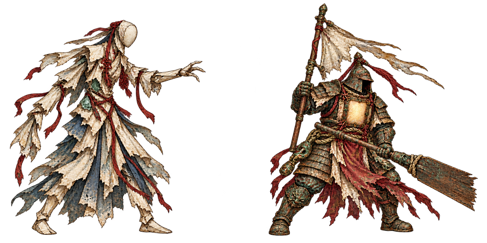

### 后六章敌方·无更巡守／主镜·护面

`assets/chars/enemies/saga/warden_master.png`

生产素材｜游戏内实际读取的后六章敌方图集。
同一张图集内按 region 切出 2 个敌种：无更巡守／主镜·护面。
切分区域与脚锚：无更巡守=[0, 0, 1006, 887]；主镜·护面=[1006, 0, 768, 887]。
图集像素 1774×887；登记来源见 assets/chars/enemies/saga/asset_manifest.json。

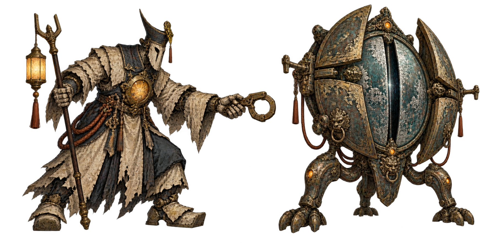

## 第一章 NPC

两名普通成年NPC，地图全身与对白半身分离绘制，独立生成、未复用敌图或主角素材。

### 守山人·老梁·地图全身精灵

`assets/chars/npcs/act_one/liang_world.png`

生产素材｜游戏内实际读取。
守山人·老梁（liang）的地图全身精灵。
画布 1024×1536，身高标尺 172 cm，头顶 [525, 64]，脚底 [400, 1483]，落地锚 [510, 1487]。
来源与审阅记录见 assets/chars/npcs/act_one/asset_manifest.json（sha256 前16位 c524a1425a940741）。
本图像素 1024×1536。

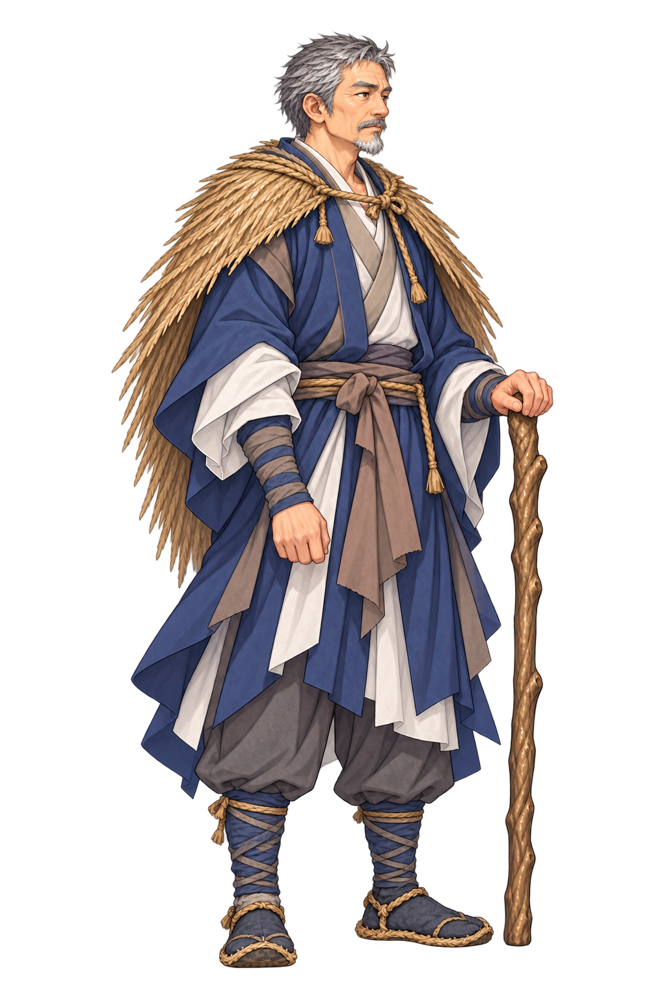

### 守山人·老梁·对白半身立绘

`assets/chars/npcs/act_one/liang_half.png`

生产素材｜游戏内实际读取。
守山人·老梁（liang）的对白半身立绘。
画布 1024×1536，身高标尺 172 cm，头顶 [525, 64]，脚底 [400, 1483]，落地锚 [510, 1487]。
来源与审阅记录见 assets/chars/npcs/act_one/asset_manifest.json（sha256 前16位 c524a1425a940741）。
本图像素 1024×1536。

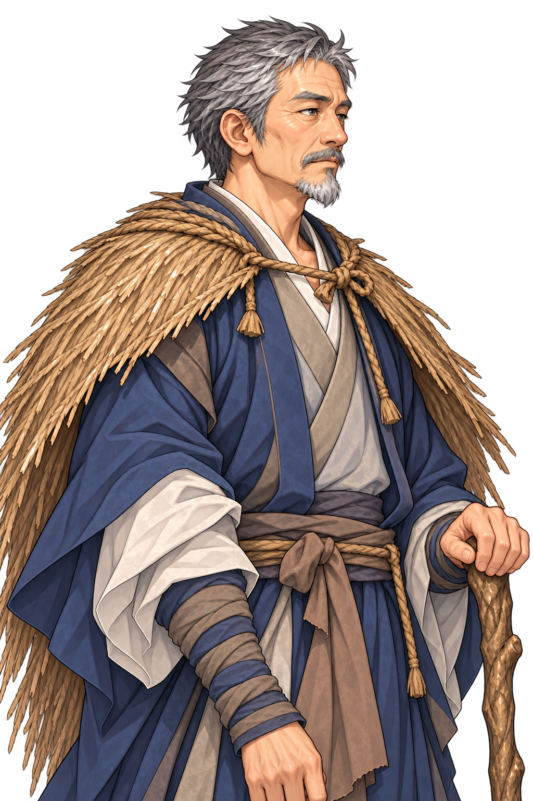

### 扫庭人·阿诚·地图全身精灵

`assets/chars/npcs/act_one/acheng_world.png`

生产素材｜游戏内实际读取。
扫庭人·阿诚（acheng）的地图全身精灵。
画布 1024×1536，身高标尺 176 cm，头顶 [518, 62]，脚底 [380, 1493]，落地锚 [470, 1497]。
来源与审阅记录见 assets/chars/npcs/act_one/asset_manifest.json（sha256 前16位 0d35589aa901b822）。
本图像素 1024×1536。

### 扫庭人·阿诚·对白半身立绘

`assets/chars/npcs/act_one/acheng_half.png`

生产素材｜游戏内实际读取。
扫庭人·阿诚（acheng）的对白半身立绘。
画布 1024×1536，身高标尺 176 cm，头顶 [518, 62]，脚底 [380, 1493]，落地锚 [470, 1497]。
来源与审阅记录见 assets/chars/npcs/act_one/asset_manifest.json（sha256 前16位 0d35589aa901b822）。
本图像素 1024×1536。

## 后六章 NPC 图集

十二张图集，每张两名角色的双视图；运行时按 world_region / portrait_region 局部取用。

### 后六章NPC·阿杏／陶婶

`assets/chars/npcs/saga/axing_taoshen.png`

生产素材｜游戏内实际读取的后六章NPC图集。
同图集内含 2 名角色：阿杏／陶婶。
每人分地图全身区域与对白半身区域：阿杏 地图[190, 40, 290, 580] / 半身[65, 645, 480, 600]；陶婶 地图[775, 40, 330, 580] / 半身[650, 645, 590, 600]。
图集画布 1254×1254；坐标约定与目检记录见 assets/chars/npcs/saga/asset_manifest.json。

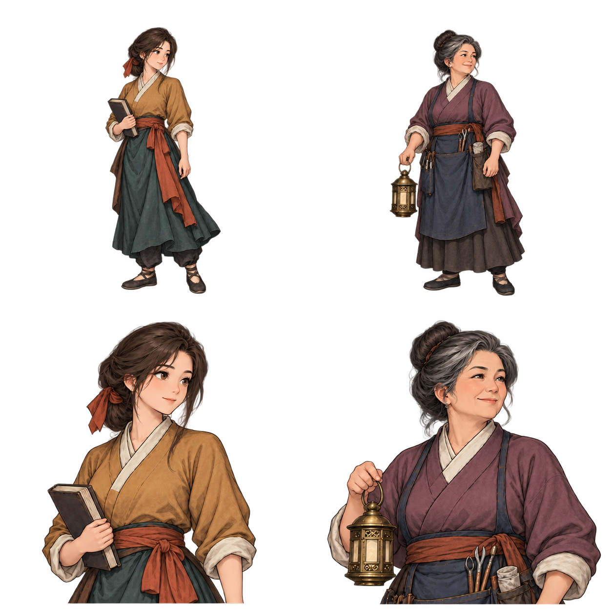

### 后六章NPC·方澄／陈葵

`assets/chars/npcs/saga/fangcheng_chenkui.png`

生产素材｜游戏内实际读取的后六章NPC图集。
同图集内含 2 名角色：方澄／陈葵。
每人分地图全身区域与对白半身区域：方澄 地图[198, 2, 266, 682] / 半身[108, 703, 474, 543]；陈葵 地图[821, 40, 261, 638] / 半身[769, 732, 401, 509]。
图集画布 1254×1254；坐标约定与目检记录见 assets/chars/npcs/saga/asset_manifest.json。

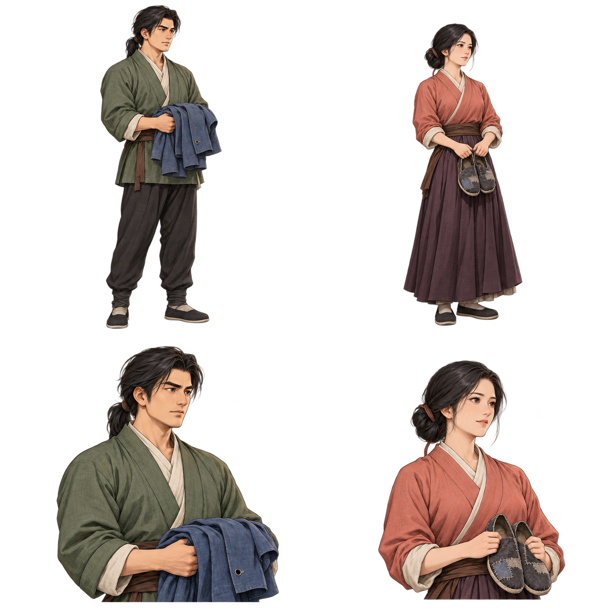

### 后六章NPC·方素／陈樵

`assets/chars/npcs/saga/fangsu_chenqiao.png`

生产素材｜游戏内实际读取的后六章NPC图集。
同图集内含 2 名角色：方素／陈樵。
每人分地图全身区域与对白半身区域：方素 地图[220, 7, 237, 658] / 半身[107, 665, 453, 589]；陈樵 地图[805, 3, 265, 661] / 半身[693, 664, 524, 590]。
图集画布 1254×1254；坐标约定与目检记录见 assets/chars/npcs/saga/asset_manifest.json。

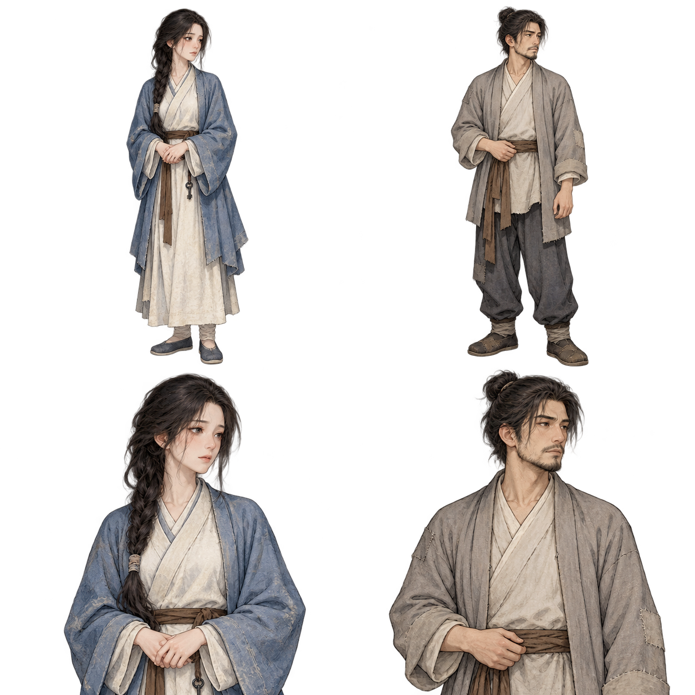

### 后六章NPC·李茂／许成

`assets/chars/npcs/saga/limao_xucheng.png`

生产素材｜游戏内实际读取的后六章NPC图集。
同图集内含 2 名角色：李茂／许成。
每人分地图全身区域与对白半身区域：李茂 地图[187, 9, 249, 642] / 半身[64, 651, 482, 596]；许成 地图[827, 8, 280, 644] / 半身[719, 655, 530, 592]。
图集画布 1254×1254；坐标约定与目检记录见 assets/chars/npcs/saga/asset_manifest.json。

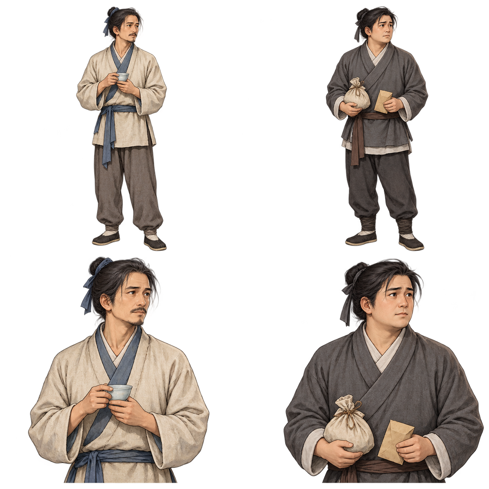

### 后六章NPC·罗婶／阿柳

`assets/chars/npcs/saga/luoshen_aliu.png`

生产素材｜游戏内实际读取的后六章NPC图集。
同图集内含 2 名角色：罗婶／阿柳。
每人分地图全身区域与对白半身区域：罗婶 地图[191, 10, 292, 699] / 半身[77, 709, 501, 543]；阿柳 地图[809, 1, 281, 708] / 半身[739, 709, 487, 543]。
图集画布 1254×1254；坐标约定与目检记录见 assets/chars/npcs/saga/asset_manifest.json。

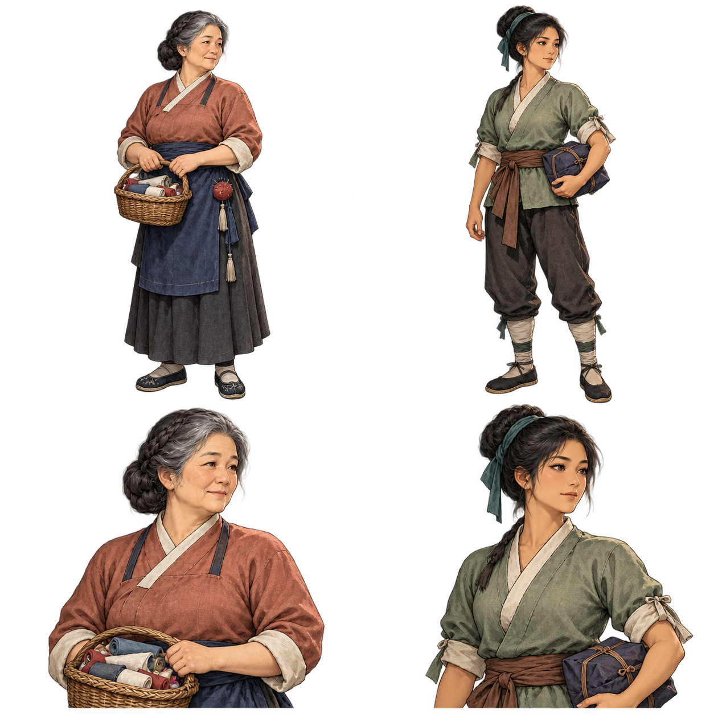

### 后六章NPC·卖饼人／罗苇

`assets/chars/npcs/saga/luowei_bingvendor.png`

生产素材｜游戏内实际读取的后六章NPC图集。
同图集内含 2 名角色：卖饼人／罗苇。
每人分地图全身区域与对白半身区域：罗苇 地图[188, 1, 288, 704] / 半身[87, 705, 467, 549]；卖饼人 地图[781, 25, 386, 682] / 半身[672, 715, 564, 539]。
图集画布 1254×1254；坐标约定与目检记录见 assets/chars/npcs/saga/asset_manifest.json。

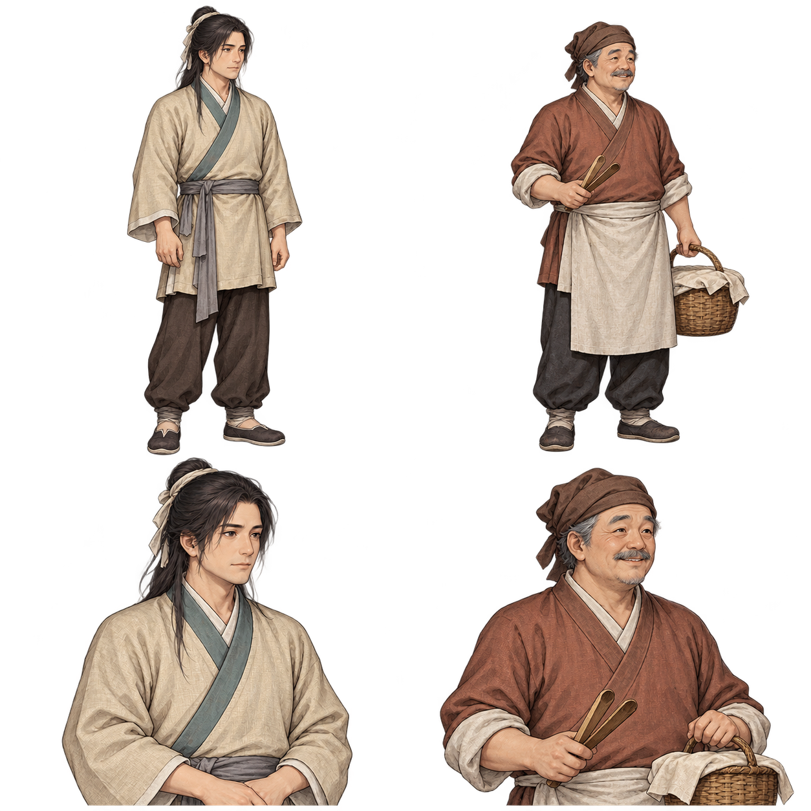

### 后六章NPC·孟衡／沈烛舟

`assets/chars/npcs/saga/mengheng_shenzhuzhou.png`

生产素材｜游戏内实际读取的后六章NPC图集。
同图集内含 2 名角色：孟衡／沈烛舟。
每人分地图全身区域与对白半身区域：孟衡 地图[140, 0, 320, 661] / 半身[20, 666, 560, 588]；沈烛舟 地图[755, 0, 380, 663] / 半身[680, 667, 540, 587]。
图集画布 1254×1254；坐标约定与目检记录见 assets/chars/npcs/saga/asset_manifest.json。

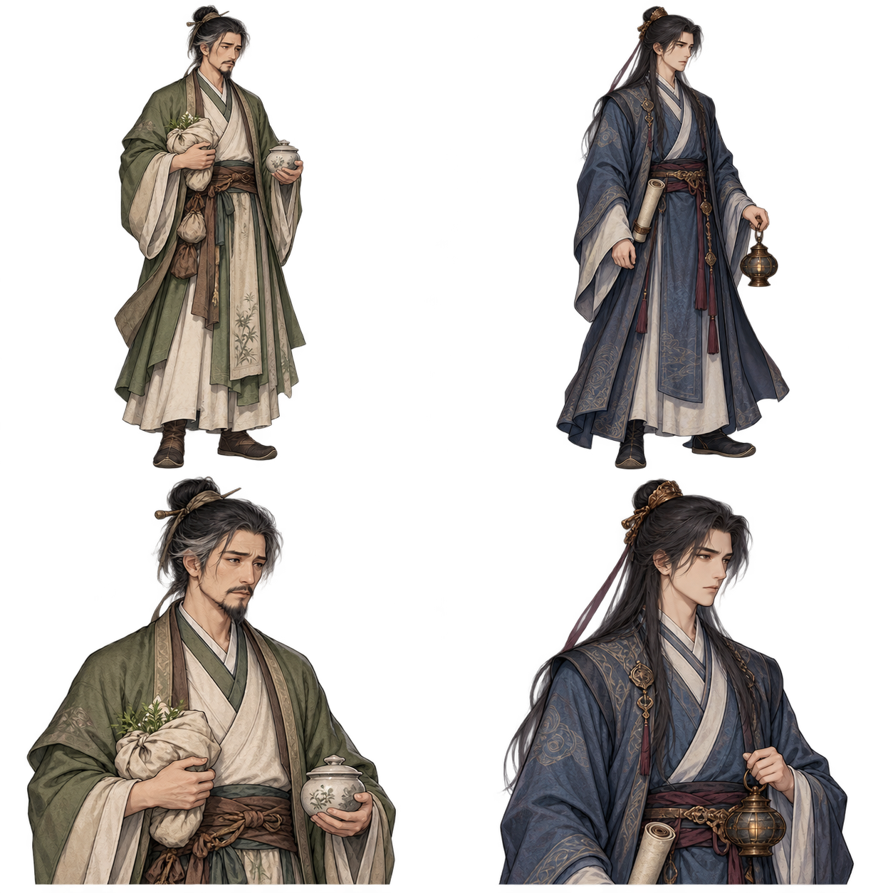

### 后六章NPC·乔伯／许照漪

`assets/chars/npcs/saga/qiaobo_xuzhaoyi.png`

生产素材｜游戏内实际读取的后六章NPC图集。
同图集内含 2 名角色：乔伯／许照漪。
每人分地图全身区域与对白半身区域：乔伯 地图[150, 0, 325, 660] / 半身[15, 660, 580, 594]；许照漪 地图[825, 0, 265, 660] / 半身[740, 675, 505, 579]。
图集画布 1254×1254；坐标约定与目检记录见 assets/chars/npcs/saga/asset_manifest.json。

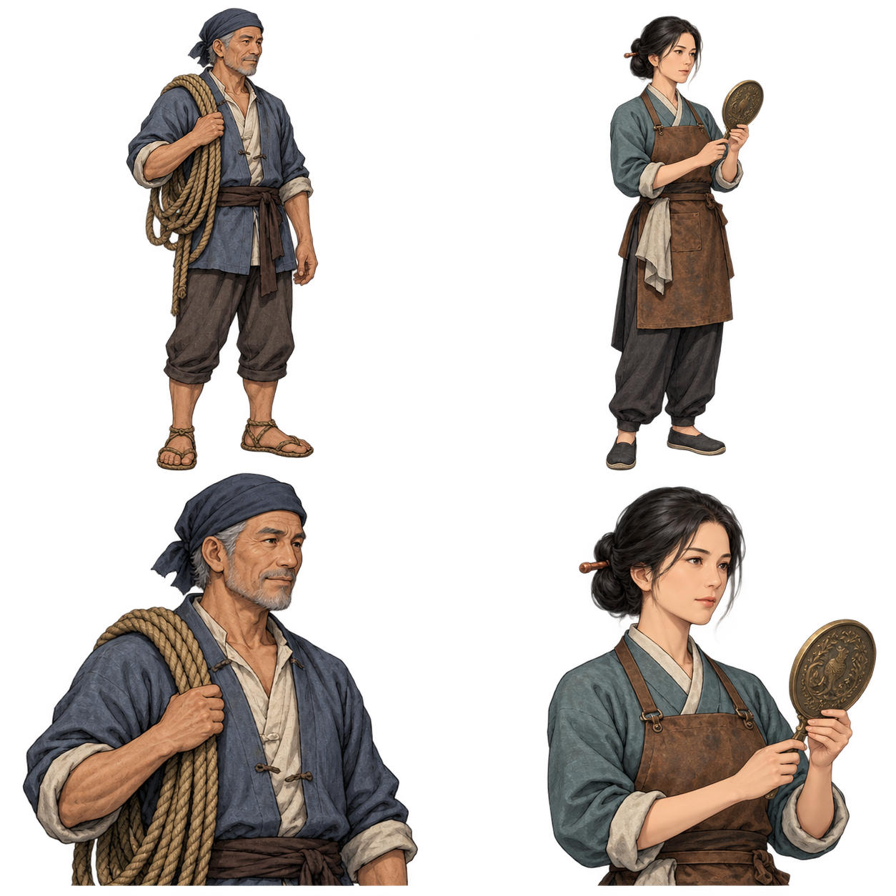

### 后六章NPC·赵医工／邱安

`assets/chars/npcs/saga/qiuan_zhaoyigong.png`

生产素材｜游戏内实际读取的后六章NPC图集。
同图集内含 2 名角色：赵医工／邱安。
每人分地图全身区域与对白半身区域：邱安 地图[188, 35, 249, 584] / 半身[35, 653, 548, 593]；赵医工 地图[849, 44, 252, 576] / 半身[708, 661, 544, 585]。
图集画布 1254×1254；坐标约定与目检记录见 assets/chars/npcs/saga/asset_manifest.json。

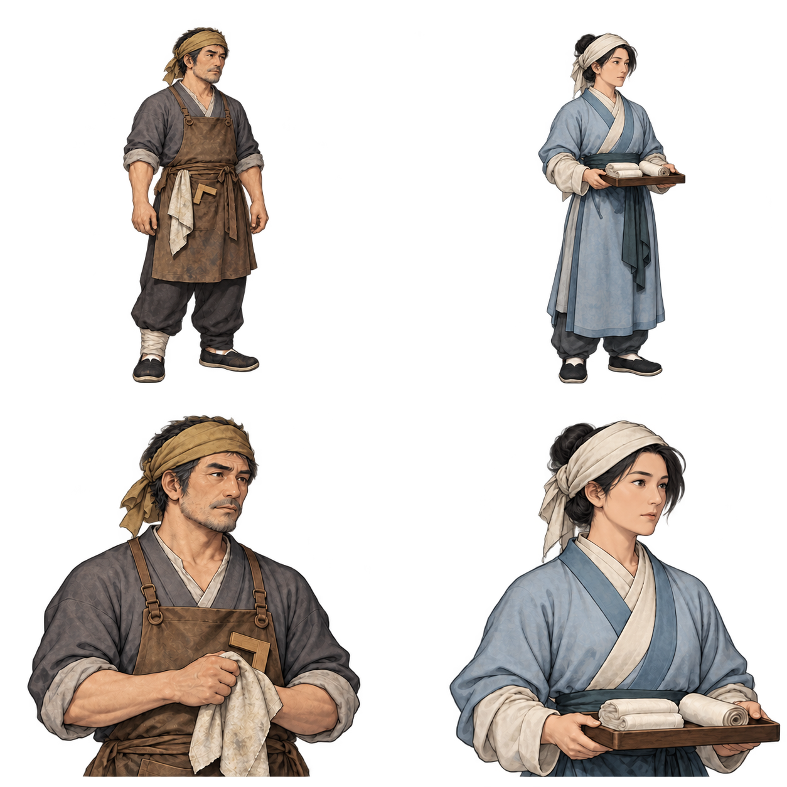

### 后六章NPC·宋婆／杜平

`assets/chars/npcs/saga/songpo_duping.png`

生产素材｜游戏内实际读取的后六章NPC图集。
同图集内含 2 名角色：宋婆／杜平。
每人分地图全身区域与对白半身区域：宋婆 地图[178, 26, 239, 622] / 半身[57, 676, 506, 572]；杜平 地图[840, 12, 230, 644] / 半身[708, 666, 499, 582]。
图集画布 1254×1254；坐标约定与目检记录见 assets/chars/npcs/saga/asset_manifest.json。

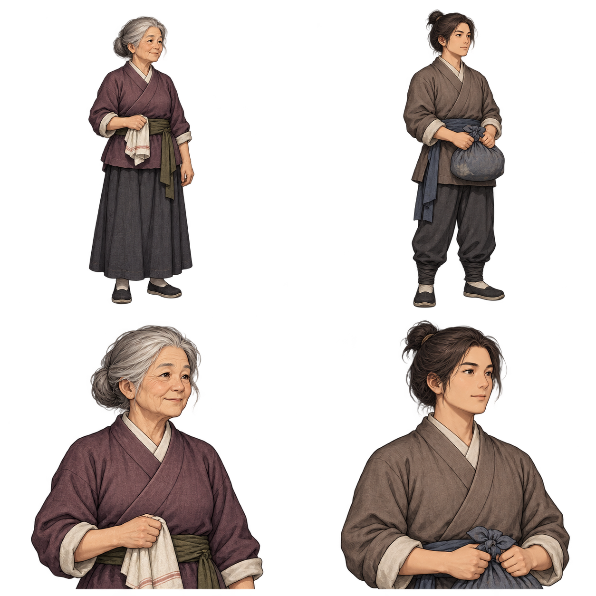

### 后六章NPC·吴济／陆芸

`assets/chars/npcs/saga/wuji_luyun.png`

生产素材｜游戏内实际读取的后六章NPC图集。
同图集内含 2 名角色：吴济／陆芸。
每人分地图全身区域与对白半身区域：吴济 地图[195, 0, 298, 676] / 半身[72, 676, 525, 578]；陆芸 地图[829, 21, 281, 654] / 半身[756, 697, 484, 557]。
图集画布 1254×1254；坐标约定与目检记录见 assets/chars/npcs/saga/asset_manifest.json。

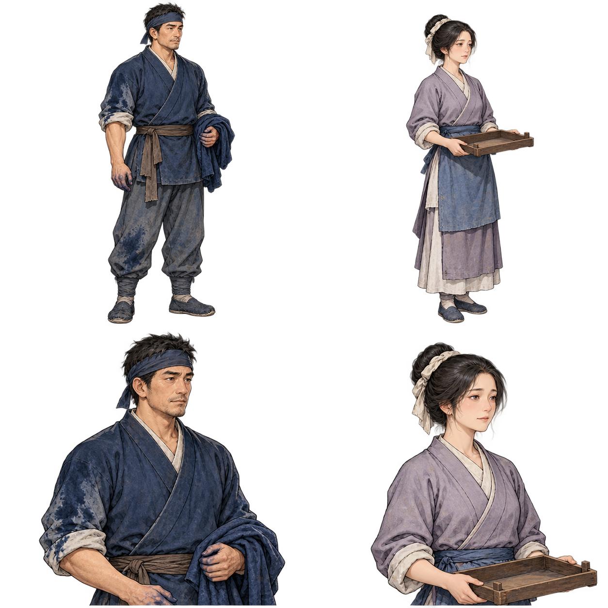

### 后六章NPC·姚芹／杜应

`assets/chars/npcs/saga/yaoqin_duying.png`

生产素材｜游戏内实际读取的后六章NPC图集。
同图集内含 2 名角色：姚芹／杜应。
每人分地图全身区域与对白半身区域：姚芹 地图[214, 20, 210, 668] / 半身[88, 697, 457, 557]；杜应 地图[815, 17, 266, 675] / 半身[678, 692, 534, 562]。
图集画布 1254×1254；坐标约定与目检记录见 assets/chars/npcs/saga/asset_manifest.json。

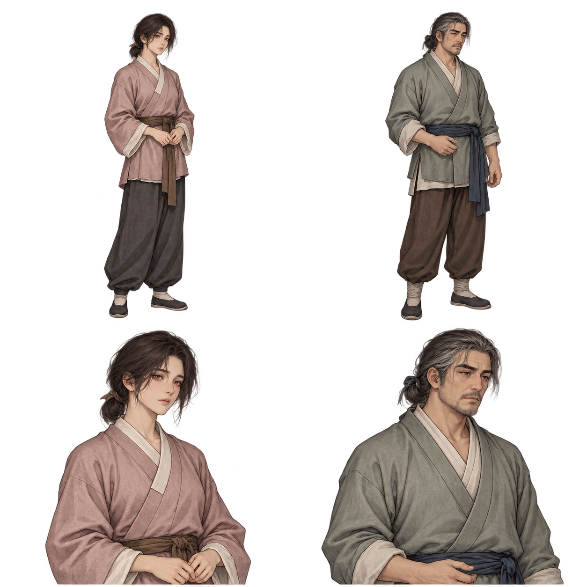

## 战斗/行走背景

res://assets/bg/ 根目录的直接舞台背景，战斗背景由 data/battles/*.json 的 bg 字段引用。

### 参道·战斗背景

`assets/bg/approach_battle.png`

生产素材｜游戏内实际读取：第一章参道战斗背景。
分组说明：res://assets/bg/ 根目录的直接舞台背景，战斗背景由 data/battles/*.json 的 bg 字段引用。
路径 assets/bg/approach_battle.png。像素 2048×1152。

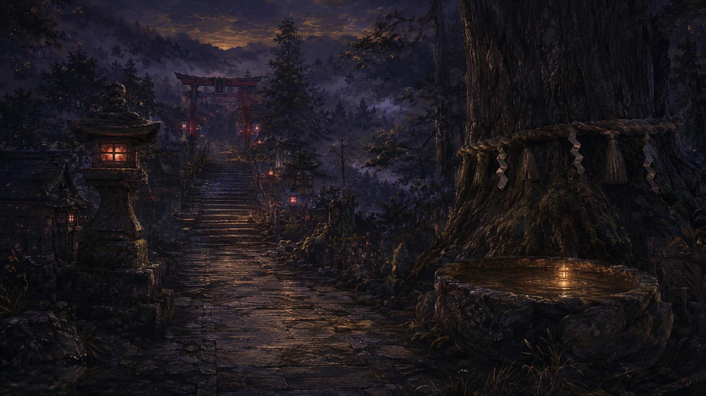

### 参道·l2 分层试样

`assets/bg/approach/l2_test.png`

生产素材｜游戏内实际读取：参道分层背景试样层。
分组说明：res://assets/bg/ 根目录的直接舞台背景，战斗背景由 data/battles/*.json 的 bg 字段引用。
路径 assets/bg/approach/l2_test.png。像素 2048×1152。

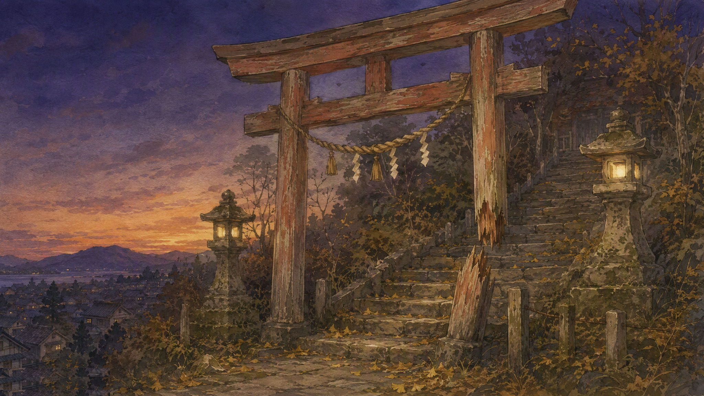

### 回廊·战斗背景

`assets/bg/corridor_battle_test.png`

生产素材｜游戏内实际读取：回廊战斗背景。
分组说明：res://assets/bg/ 根目录的直接舞台背景，战斗背景由 data/battles/*.json 的 bg 字段引用。
路径 assets/bg/corridor_battle_test.png。像素 2048×1152。

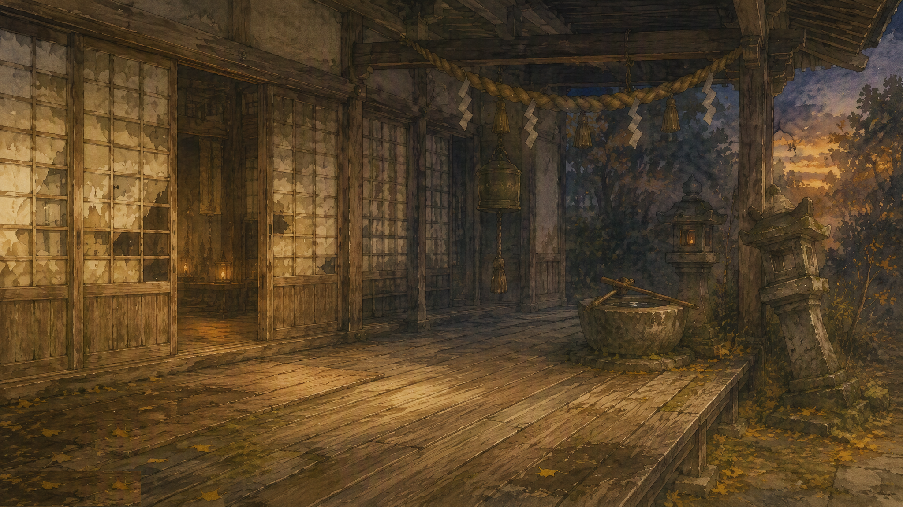

### 回廊·行走背景

`assets/bg/corridor_walk.png`

生产素材｜游戏内实际读取：回廊行走舞台背景。
分组说明：res://assets/bg/ 根目录的直接舞台背景，战斗背景由 data/battles/*.json 的 bg 字段引用。
路径 assets/bg/corridor_walk.png。像素 2048×1152。

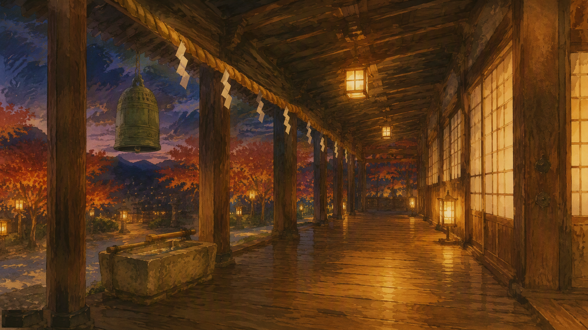

### 本殿·战斗背景

`assets/bg/honden_battle.png`

生产素材｜游戏内实际读取：本殿战斗背景。
分组说明：res://assets/bg/ 根目录的直接舞台背景，战斗背景由 data/battles/*.json 的 bg 字段引用。
路径 assets/bg/honden_battle.png。像素 2048×1152。

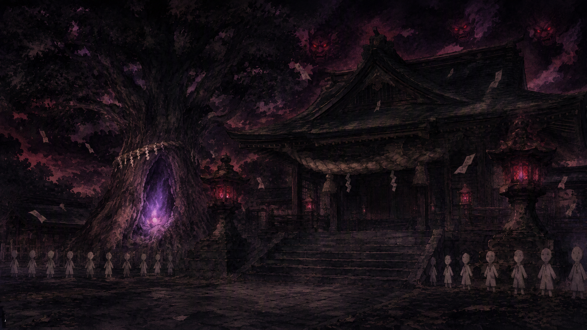

### 本殿·黄昏背景

`assets/bg/honden_dusk.png`

生产素材｜游戏内实际读取：本殿黄昏氛围背景。
分组说明：res://assets/bg/ 根目录的直接舞台背景，战斗背景由 data/battles/*.json 的 bg 字段引用。
路径 assets/bg/honden_dusk.png。像素 2048×1152。

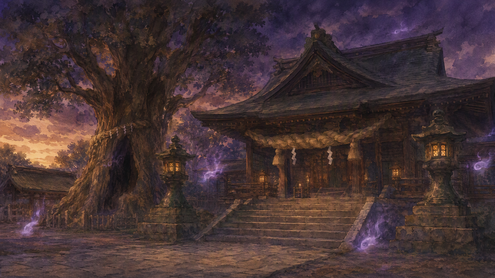

### 参道·远景

`assets/bg/mountain_path/far.png`

生产素材｜游戏内实际读取：上山路远景层。
分组说明：res://assets/bg/ 根目录的直接舞台背景，战斗背景由 data/battles/*.json 的 bg 字段引用。
路径 assets/bg/mountain_path/far.png。像素 2048×1152。

### 参道·鸟居

`assets/bg/mountain_path/arch.png`

生产素材｜游戏内实际读取：上山路鸟居前景层。
分组说明：res://assets/bg/ 根目录的直接舞台背景，战斗背景由 data/battles/*.json 的 bg 字段引用。
路径 assets/bg/mountain_path/arch.png。像素 2048×1152。

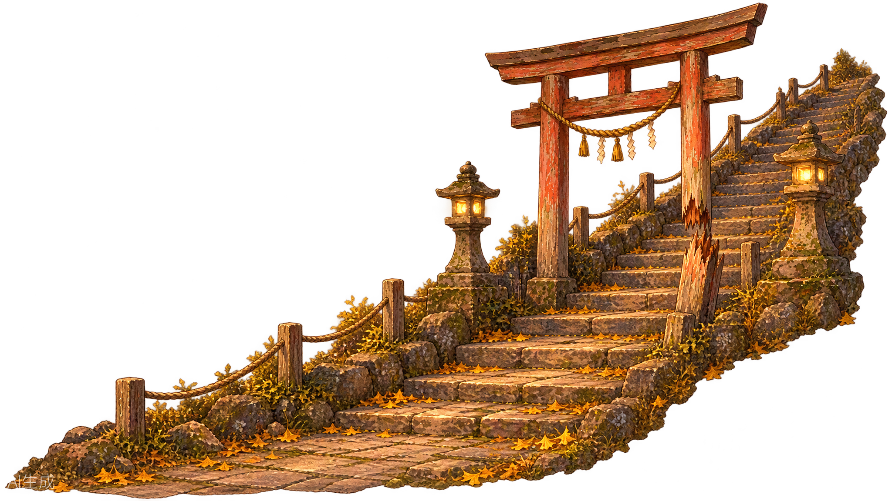

## 前景视差层

scripts/scenes/stage_scene.gd 按 res://assets/bg/parallax/<舞台id>_fg1.png 约定加载的透明前景层。

### 参道·前景层

`assets/bg/parallax/test_approach_fg1.png`

生产素材｜游戏内实际读取：舞台 test_approach 的 fg1。
分组说明：scripts/scenes/stage_scene.gd 按 res://assets/bg/parallax/<舞台id>_fg1.png 约定加载的透明前景层。
路径 assets/bg/parallax/test_approach_fg1.png。像素 2048×1152。

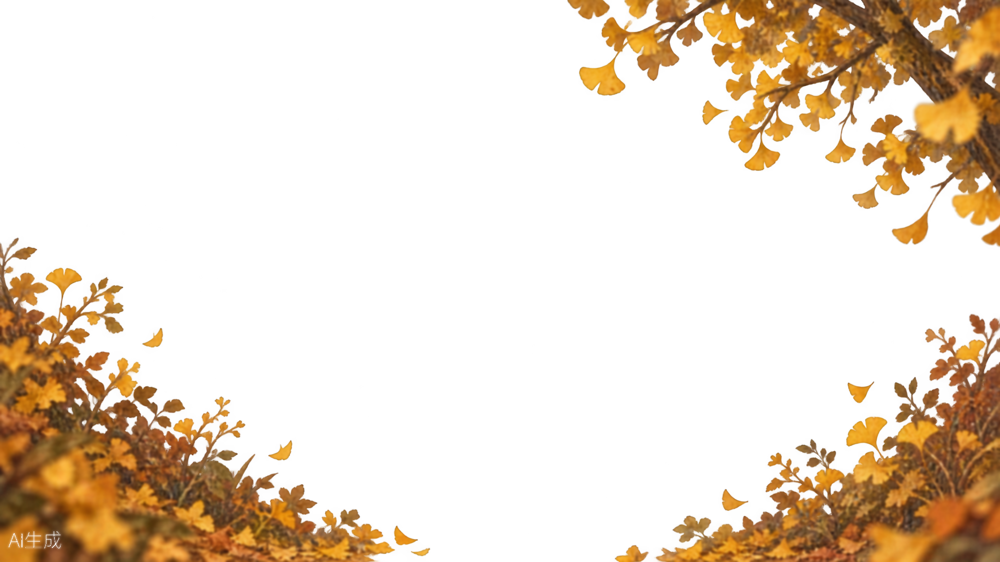

### 回廊·前景层

`assets/bg/parallax/corridor_act_fg1.png`

生产素材｜游戏内实际读取：舞台 corridor_act 的 fg1。
分组说明：scripts/scenes/stage_scene.gd 按 res://assets/bg/parallax/<舞台id>_fg1.png 约定加载的透明前景层。
路径 assets/bg/parallax/corridor_act_fg1.png。像素 2048×1152。

### 本殿·前景层

`assets/bg/parallax/honden_act_fg1.png`

生产素材｜游戏内实际读取：舞台 honden_act 的 fg1。
分组说明：scripts/scenes/stage_scene.gd 按 res://assets/bg/parallax/<舞台id>_fg1.png 约定加载的透明前景层。
路径 assets/bg/parallax/honden_act_fg1.png。像素 2048×1152。

### 上山路·前景层

`assets/bg/parallax/mountain_path_fg1.png`

生产素材｜游戏内实际读取：舞台 mountain_path 的 fg1。
分组说明：scripts/scenes/stage_scene.gd 按 res://assets/bg/parallax/<舞台id>_fg1.png 约定加载的透明前景层。
路径 assets/bg/parallax/mountain_path_fg1.png。像素 2048×1152。

## 遮挡层

场景内用于遮挡角色的透明遮挡图，由舞台配置指定层级。

### 本殿遮挡 o0

`assets/bg/occluders/honden_act_o0.png`

生产素材｜游戏内实际读取：本殿舞台遮挡层。
分组说明：场景内用于遮挡角色的透明遮挡图，由舞台配置指定层级。
路径 assets/bg/occluders/honden_act_o0.png。像素 174×332。

### 参道遮挡 o0

`assets/bg/occluders/test_approach_o0.png`

生产素材｜游戏内实际读取：参道舞台遮挡层 o0。
分组说明：场景内用于遮挡角色的透明遮挡图，由舞台配置指定层级。
路径 assets/bg/occluders/test_approach_o0.png。像素 135×272。

### 参道遮挡 o1

`assets/bg/occluders/test_approach_o1.png`

生产素材｜游戏内实际读取：参道舞台遮挡层 o1。
分组说明：场景内用于遮挡角色的透明遮挡图，由舞台配置指定层级。
路径 assets/bg/occluders/test_approach_o1.png。像素 77×207。

## 可行走遮罩

scripts/scenes/stage_scene.gd 按 res://assets/bg/walkmasks/<舞台id>.png 读取：白色为可行走面，顶缘高度即落脚高度。

### 参道可行走遮罩

`assets/bg/walkmasks/test_approach.png`

生产素材｜游戏内实际读取：舞台 test_approach 行走遮罩。
分组说明：scripts/scenes/stage_scene.gd 按 res://assets/bg/walkmasks/<舞台id>.png 读取：白色为可行走面，顶缘高度即落脚高度。
路径 assets/bg/walkmasks/test_approach.png。像素 2048×1152。

### 回廊可行走遮罩

`assets/bg/walkmasks/corridor_act.png`

生产素材｜游戏内实际读取：舞台 corridor_act 行走遮罩。
分组说明：scripts/scenes/stage_scene.gd 按 res://assets/bg/walkmasks/<舞台id>.png 读取：白色为可行走面，顶缘高度即落脚高度。
路径 assets/bg/walkmasks/corridor_act.png。像素 2048×1152。

### 本殿可行走遮罩

`assets/bg/walkmasks/honden_act.png`

生产素材｜游戏内实际读取：舞台 honden_act 行走遮罩。
分组说明：scripts/scenes/stage_scene.gd 按 res://assets/bg/walkmasks/<舞台id>.png 读取：白色为可行走面，顶缘高度即落脚高度。
路径 assets/bg/walkmasks/honden_act.png。像素 2048×1152。

### 上山路可行走遮罩

`assets/bg/walkmasks/mountain_path.png`

生产素材｜游戏内实际读取：舞台 mountain_path 行走遮罩。
分组说明：scripts/scenes/stage_scene.gd 按 res://assets/bg/walkmasks/<舞台id>.png 读取：白色为可行走面，顶缘高度即落脚高度。
路径 assets/bg/walkmasks/mountain_path.png。像素 2048×1152。

## 3D 阶段模型

第一章连续寺域的六个 glTF 阶段：上山路、回廊、回廊 HD2D 变体、送葬行列、镜殿、本殿。

### 第一幕 参道·GLB

`assets/3d/act01_approach/act01_approach.glb`

生产素材｜游戏内实际导入的 3D 阶段模型。
第一幕 参道，目录 assets/3d/act01_approach/。
GLB 内嵌 PBR 材质与打包纹理，Blender 源与构建脚本在同级 source/（带 .gdignore，不参与导出）。
尺寸 10.4 MB；坐标、锚点与实测预算见目录内 README.md。

### 第二夜 回廊·GLB

`assets/3d/night02_corridor/night02_corridor.glb`

生产素材｜游戏内实际导入的 3D 阶段模型。
第二夜 回廊，目录 assets/3d/night02_corridor/。
GLB 内嵌 PBR 材质与打包纹理，Blender 源与构建脚本在同级 source/（带 .gdignore，不参与导出）。
尺寸 12.1 MB；坐标、锚点与实测预算见目录内 README.md。

### 第二夜 回廊 HD2D 变体·GLB

`assets/3d/night02_corridor_hd2d/night02_corridor_hd2d.glb`

生产素材｜游戏内实际导入的 3D 阶段模型。
第二夜 回廊 HD2D 变体，目录 assets/3d/night02_corridor_hd2d/。
GLB 内嵌 PBR 材质与打包纹理，Blender 源与构建脚本在同级 source/（带 .gdignore，不参与导出）。
尺寸 14.0 MB；坐标、锚点与实测预算见目录内 README.md。

### 第三夜 送葬行列·GLB

`assets/3d/night03_procession/night03_procession.glb`

生产素材｜游戏内实际导入的 3D 阶段模型。
第三夜 送葬行列，目录 assets/3d/night03_procession/。
GLB 内嵌 PBR 材质与打包纹理，Blender 源与构建脚本在同级 source/（带 .gdignore，不参与导出）。
尺寸 8.2 MB；坐标、锚点与实测预算见目录内 README.md。

### 第四夜 镜殿·GLB

`assets/3d/night04_mirror/night04_mirror.glb`

生产素材｜游戏内实际导入的 3D 阶段模型。
第四夜 镜殿，目录 assets/3d/night04_mirror/。
GLB 内嵌 PBR 材质与打包纹理，Blender 源与构建脚本在同级 source/（带 .gdignore，不参与导出）。
尺寸 8.2 MB；坐标、锚点与实测预算见目录内 README.md。

### 第五夜 本殿·GLB

`assets/3d/night05_honden/night05_honden.glb`

生产素材｜游戏内实际导入的 3D 阶段模型。
第五夜 本殿，目录 assets/3d/night05_honden/。
GLB 内嵌 PBR 材质与打包纹理，Blender 源与构建脚本在同级 source/（带 .gdignore，不参与导出）。
尺寸 8.2 MB；坐标、锚点与实测预算见目录内 README.md。

## 3D 阶段贴图

各阶段按材质导出的独立贴图（和纸/灰泥/瓦/石/木）；参道阶段只导出 GLB，贴图内嵌在模型内。

### 第二夜 回廊·和纸贴图

`assets/3d/night02_corridor/night02_corridor_paper.png`

生产素材｜3D 阶段贴图：第二夜 回廊的和纸材质。
路径 assets/3d/night02_corridor/night02_corridor_paper.png；scripts/campaign/act_one_geometry.gd 等脚本按名 preload，与同名 GLB 的内嵌贴图对应同一套材质设定。
像素 1024×1024，816 KB。

### 第二夜 回廊·灰泥贴图

`assets/3d/night02_corridor/night02_corridor_plaster.png`

生产素材｜3D 阶段贴图：第二夜 回廊的灰泥材质。
路径 assets/3d/night02_corridor/night02_corridor_plaster.png；scripts/campaign/act_one_geometry.gd 等脚本按名 preload，与同名 GLB 的内嵌贴图对应同一套材质设定。
像素 768×768，260 KB。

### 第二夜 回廊·瓦贴图

`assets/3d/night02_corridor/night02_corridor_roof.png`

生产素材｜3D 阶段贴图：第二夜 回廊的瓦材质。
路径 assets/3d/night02_corridor/night02_corridor_roof.png；scripts/campaign/act_one_geometry.gd 等脚本按名 preload，与同名 GLB 的内嵌贴图对应同一套材质设定。
像素 768×768，209 KB。

### 第二夜 回廊·石贴图

`assets/3d/night02_corridor/night02_corridor_stone.png`

生产素材｜3D 阶段贴图：第二夜 回廊的石材质。
路径 assets/3d/night02_corridor/night02_corridor_stone.png；scripts/campaign/act_one_geometry.gd 等脚本按名 preload，与同名 GLB 的内嵌贴图对应同一套材质设定。
像素 768×768，406 KB。

### 第二夜 回廊·木贴图

`assets/3d/night02_corridor/night02_corridor_wood.png`

生产素材｜3D 阶段贴图：第二夜 回廊的木材质。
路径 assets/3d/night02_corridor/night02_corridor_wood.png；scripts/campaign/act_one_geometry.gd 等脚本按名 preload，与同名 GLB 的内嵌贴图对应同一套材质设定。
像素 768×768，315 KB。

### 第二夜 回廊 HD2D 变体·和纸贴图

`assets/3d/night02_corridor_hd2d/night02_corridor_hd2d_paper.png`

生产素材｜3D 阶段贴图：第二夜 回廊 HD2D 变体的和纸材质。
路径 assets/3d/night02_corridor_hd2d/night02_corridor_hd2d_paper.png；scripts/campaign/act_one_geometry.gd 等脚本按名 preload，与同名 GLB 的内嵌贴图对应同一套材质设定。
像素 1024×1024，816 KB。

### 第二夜 回廊 HD2D 变体·灰泥贴图

`assets/3d/night02_corridor_hd2d/night02_corridor_hd2d_plaster.png`

生产素材｜3D 阶段贴图：第二夜 回廊 HD2D 变体的灰泥材质。
路径 assets/3d/night02_corridor_hd2d/night02_corridor_hd2d_plaster.png；scripts/campaign/act_one_geometry.gd 等脚本按名 preload，与同名 GLB 的内嵌贴图对应同一套材质设定。
像素 768×768，260 KB。

### 第二夜 回廊 HD2D 变体·瓦贴图

`assets/3d/night02_corridor_hd2d/night02_corridor_hd2d_roof.png`

生产素材｜3D 阶段贴图：第二夜 回廊 HD2D 变体的瓦材质。
路径 assets/3d/night02_corridor_hd2d/night02_corridor_hd2d_roof.png；scripts/campaign/act_one_geometry.gd 等脚本按名 preload，与同名 GLB 的内嵌贴图对应同一套材质设定。
像素 768×768，209 KB。

### 第二夜 回廊 HD2D 变体·石贴图

`assets/3d/night02_corridor_hd2d/night02_corridor_hd2d_stone.png`

生产素材｜3D 阶段贴图：第二夜 回廊 HD2D 变体的石材质。
路径 assets/3d/night02_corridor_hd2d/night02_corridor_hd2d_stone.png；scripts/campaign/act_one_geometry.gd 等脚本按名 preload，与同名 GLB 的内嵌贴图对应同一套材质设定。
像素 768×768，406 KB。

### 第二夜 回廊 HD2D 变体·木贴图

`assets/3d/night02_corridor_hd2d/night02_corridor_hd2d_wood.png`

生产素材｜3D 阶段贴图：第二夜 回廊 HD2D 变体的木材质。
路径 assets/3d/night02_corridor_hd2d/night02_corridor_hd2d_wood.png；scripts/campaign/act_one_geometry.gd 等脚本按名 preload，与同名 GLB 的内嵌贴图对应同一套材质设定。
像素 768×768，315 KB。

### 第三夜 送葬行列·和纸贴图

`assets/3d/night03_procession/night03_procession_paper.png`

生产素材｜3D 阶段贴图：第三夜 送葬行列的和纸材质。
路径 assets/3d/night03_procession/night03_procession_paper.png；scripts/campaign/act_one_geometry.gd 等脚本按名 preload，与同名 GLB 的内嵌贴图对应同一套材质设定。
像素 1024×1024，816 KB。

### 第三夜 送葬行列·石贴图

`assets/3d/night03_procession/night03_procession_stone.png`

生产素材｜3D 阶段贴图：第三夜 送葬行列的石材质。
路径 assets/3d/night03_procession/night03_procession_stone.png；scripts/campaign/act_one_geometry.gd 等脚本按名 preload，与同名 GLB 的内嵌贴图对应同一套材质设定。
像素 768×768，406 KB。

### 第三夜 送葬行列·木贴图

`assets/3d/night03_procession/night03_procession_wood.png`

生产素材｜3D 阶段贴图：第三夜 送葬行列的木材质。
路径 assets/3d/night03_procession/night03_procession_wood.png；scripts/campaign/act_one_geometry.gd 等脚本按名 preload，与同名 GLB 的内嵌贴图对应同一套材质设定。
像素 768×768，315 KB。

### 第四夜 镜殿·和纸贴图

`assets/3d/night04_mirror/night04_mirror_paper.png`

生产素材｜3D 阶段贴图：第四夜 镜殿的和纸材质。
路径 assets/3d/night04_mirror/night04_mirror_paper.png；scripts/campaign/act_one_geometry.gd 等脚本按名 preload，与同名 GLB 的内嵌贴图对应同一套材质设定。
像素 1024×1024，816 KB。

### 第四夜 镜殿·灰泥贴图

`assets/3d/night04_mirror/night04_mirror_plaster.png`

生产素材｜3D 阶段贴图：第四夜 镜殿的灰泥材质。
路径 assets/3d/night04_mirror/night04_mirror_plaster.png；scripts/campaign/act_one_geometry.gd 等脚本按名 preload，与同名 GLB 的内嵌贴图对应同一套材质设定。
像素 768×768，260 KB。

### 第四夜 镜殿·瓦贴图

`assets/3d/night04_mirror/night04_mirror_roof.png`

生产素材｜3D 阶段贴图：第四夜 镜殿的瓦材质。
路径 assets/3d/night04_mirror/night04_mirror_roof.png；scripts/campaign/act_one_geometry.gd 等脚本按名 preload，与同名 GLB 的内嵌贴图对应同一套材质设定。
像素 768×768，209 KB。

### 第四夜 镜殿·石贴图

`assets/3d/night04_mirror/night04_mirror_stone.png`

生产素材｜3D 阶段贴图：第四夜 镜殿的石材质。
路径 assets/3d/night04_mirror/night04_mirror_stone.png；scripts/campaign/act_one_geometry.gd 等脚本按名 preload，与同名 GLB 的内嵌贴图对应同一套材质设定。
像素 768×768，406 KB。

### 第四夜 镜殿·木贴图

`assets/3d/night04_mirror/night04_mirror_wood.png`

生产素材｜3D 阶段贴图：第四夜 镜殿的木材质。
路径 assets/3d/night04_mirror/night04_mirror_wood.png；scripts/campaign/act_one_geometry.gd 等脚本按名 preload，与同名 GLB 的内嵌贴图对应同一套材质设定。
像素 768×768，315 KB。

### 第五夜 本殿·和纸贴图

`assets/3d/night05_honden/night05_honden_paper.png`

生产素材｜3D 阶段贴图：第五夜 本殿的和纸材质。
路径 assets/3d/night05_honden/night05_honden_paper.png；scripts/campaign/act_one_geometry.gd 等脚本按名 preload，与同名 GLB 的内嵌贴图对应同一套材质设定。
像素 1024×1024，816 KB。

### 第五夜 本殿·灰泥贴图

`assets/3d/night05_honden/night05_honden_plaster.png`

生产素材｜3D 阶段贴图：第五夜 本殿的灰泥材质。
路径 assets/3d/night05_honden/night05_honden_plaster.png；scripts/campaign/act_one_geometry.gd 等脚本按名 preload，与同名 GLB 的内嵌贴图对应同一套材质设定。
像素 768×768，260 KB。

### 第五夜 本殿·瓦贴图

`assets/3d/night05_honden/night05_honden_roof.png`

生产素材｜3D 阶段贴图：第五夜 本殿的瓦材质。
路径 assets/3d/night05_honden/night05_honden_roof.png；scripts/campaign/act_one_geometry.gd 等脚本按名 preload，与同名 GLB 的内嵌贴图对应同一套材质设定。
像素 768×768，209 KB。

### 第五夜 本殿·石贴图

`assets/3d/night05_honden/night05_honden_stone.png`

生产素材｜3D 阶段贴图：第五夜 本殿的石材质。
路径 assets/3d/night05_honden/night05_honden_stone.png；scripts/campaign/act_one_geometry.gd 等脚本按名 preload，与同名 GLB 的内嵌贴图对应同一套材质设定。
像素 768×768，406 KB。

### 第五夜 本殿·木贴图

`assets/3d/night05_honden/night05_honden_wood.png`

生产素材｜3D 阶段贴图：第五夜 本殿的木材质。
路径 assets/3d/night05_honden/night05_honden_wood.png；scripts/campaign/act_one_geometry.gd 等脚本按名 preload，与同名 GLB 的内嵌贴图对应同一套材质设定。
像素 768×768，315 KB。

## 技能战斗图集（已接运行时）

imagegen_spells 下 24 个技能、28 个形态变体的运行时图集，全部在 registry.json 中获批并已通过玩法验收。

### 奇袭·薄荷图集

`assets/effects/imagegen_spells/ambush/ambush-atlas-runtime-256.png`

生产素材｜战斗运行时技能图集（registry.json 登记，approved_for_runtime=true，gameplay_qa_pending=false）。
技能 ambush「奇袭」，归属 薄荷。
单形态通用图集。
运行时图集 assets/effects/imagegen_spells/ambush/ambush-atlas-runtime-256.png（显示 256 px，缩放 0.5），16 帧。
分相：cast [1, 2, 3, 4]、travel [5, 6, 7, 8]、damage_recovery [9, 10, 11, 12]、mark_apply_sustain [13, 14, 15, 16]；清单 assets/effects/imagegen_spells/ambush/manifest.json（sha256 前16位 310f1b9da019bed7）。
图集像素 1024×1024。

### 破甲斩·焰华·剑形态图集

`assets/effects/imagegen_spells/homura_sword-armor_break/homura_sword-armor_break-atlas-runtime-256.png`

生产素材｜战斗运行时技能图集（registry.json 登记，approved_for_runtime=true，gameplay_qa_pending=false）。
技能 armor_break「破甲斩」，归属 焰华·剑形态。
近战形态变体：焰华·剑形态专属版，与另一近战形态各自独立，不共用美术。
运行时图集 assets/effects/imagegen_spells/homura_sword-armor_break/homura_sword-armor_break-atlas-runtime-256.png（显示 256 px，缩放 0.5），16 帧。
分相：cast [1, 2, 3, 4]、contact_damage [5, 6, 7, 8]、armor_break_status [9, 10, 11, 12]、conditional_burn [13, 14, 15, 16]；清单 assets/effects/imagegen_spells/homura_sword-armor_break/manifest.json（sha256 前16位 99e06f75e831d4d0）。
图集像素 1024×1024。

### 破甲斩·凛音图集

`assets/effects/imagegen_spells/rinne-armor_break/rinne-armor_break-atlas-runtime-256.png`

生产素材｜战斗运行时技能图集（registry.json 登记，approved_for_runtime=true，gameplay_qa_pending=false）。
技能 armor_break「破甲斩」，归属 凛音。
近战形态变体：凛音专属版，与另一近战形态各自独立，不共用美术。
运行时图集 assets/effects/imagegen_spells/rinne-armor_break/rinne-armor_break-atlas-runtime-256.png（显示 256 px，缩放 0.5），16 帧。
分相：cast [1, 2, 3, 4]、contact_damage [5, 6, 7, 8]、armor_break_status [9, 10, 11, 12]、conditional_weaken [13, 14, 15, 16]；清单 assets/effects/imagegen_spells/rinne-armor_break/manifest.json（sha256 前16位 55101bfc1a1ed6b0）。
图集像素 1024×1024。

### 战意·焰华·剑形态图集

`assets/effects/imagegen_spells/homura_sword-battle_spirit/homura_sword-battle_spirit-atlas-runtime-256.png`

生产素材｜战斗运行时技能图集（registry.json 登记，approved_for_runtime=true，gameplay_qa_pending=false）。
技能 battle_spirit「战意」，归属 焰华·剑形态。
近战形态变体：焰华·剑形态专属版，与另一近战形态各自独立，不共用美术。
运行时图集 assets/effects/imagegen_spells/homura_sword-battle_spirit/homura_sword-battle_spirit-atlas-runtime-256.png（显示 256 px，缩放 0.5），16 帧。
分相：cast [1, 2, 3, 4]、battle_spirit_apply [5, 6, 7, 8]、battle_spirit_status [9, 10, 11, 12]、conditional_shield [13, 14, 15, 16]；清单 assets/effects/imagegen_spells/homura_sword-battle_spirit/manifest.json（sha256 前16位 d6b1d6f4498ec7e1）。
图集像素 1024×1024。

### 战意·凛音图集

`assets/effects/imagegen_spells/rinne-battle_spirit/rinne-battle_spirit-atlas-runtime-256.png`

生产素材｜战斗运行时技能图集（registry.json 登记，approved_for_runtime=true，gameplay_qa_pending=false）。
技能 battle_spirit「战意」，归属 凛音。
近战形态变体：凛音专属版，与另一近战形态各自独立，不共用美术。
运行时图集 assets/effects/imagegen_spells/rinne-battle_spirit/rinne-battle_spirit-atlas-runtime-256.png（显示 256 px，缩放 0.5），16 帧。
分相：cast [1, 2, 3, 4]、battle_spirit_apply [5, 6, 7, 8]、recovery [9, 10, 11, 12]、battle_spirit_status [13, 14, 15, 16]；清单 assets/effects/imagegen_spells/rinne-battle_spirit/manifest.json（sha256 前16位 1f406d1570e98639）。
图集像素 1024×1024。

### burn_brand·通用图集

`assets/effects/imagegen_spells/burn_brand/burn_brand-atlas-runtime-256.png`

生产素材｜战斗运行时技能图集（registry.json 登记，approved_for_runtime=true，gameplay_qa_pending=false）。
技能 burn_brand「」，归属 通用。
单形态通用图集。
运行时图集 assets/effects/imagegen_spells/burn_brand/burn_brand-atlas-runtime-256.png（显示 256 px，缩放 0.5），16 帧。
分相：cast [1, 2, 3, 4]、travel [5, 6, 7, 8]、hit [9, 10, 11, 12]、recovery_tail [11, 12]、status [13, 14, 15, 16]；清单 assets/effects/imagegen_spells/burn_brand/manifest.json（sha256 前16位 c6ead7fa245cd92f）。
图集像素 1024×1024。

### cleanse·通用图集

`assets/effects/imagegen_spells/cleanse/cleanse-atlas-runtime-256.png`

生产素材｜战斗运行时技能图集（registry.json 登记，approved_for_runtime=true，gameplay_qa_pending=false）。
技能 cleanse「」，归属 通用。
单形态通用图集。
运行时图集 assets/effects/imagegen_spells/cleanse/cleanse-atlas-runtime-256.png（显示 256 px，缩放 0.5），16 帧。
分相：cast [1, 2, 3, 4]、travel [5, 6, 7, 8]、cleanse_removal [9, 10, 11, 12]、rejuvenation_heal [13, 14, 15, 16]、recovery_tail [11, 12, 15, 16]；清单 assets/effects/imagegen_spells/cleanse/manifest.json（sha256 前16位 3cae360a4cdfd191）。
图集像素 1024×1024。

### 掩护·岑照图集

`assets/effects/imagegen_spells/cover/cover-atlas-runtime-256.png`

生产素材｜战斗运行时技能图集（registry.json 登记，approved_for_runtime=true，gameplay_qa_pending=false）。
技能 cover「掩护」，归属 岑照。
单形态通用图集。
运行时图集 assets/effects/imagegen_spells/cover/cover-atlas-runtime-256.png（显示 256 px，缩放 0.5），16 帧。
分相：cast [1, 2, 3, 4]、cover_link [5, 6, 7, 8]、cover_status [9, 10, 11, 12]、cover_redirected [13, 14, 15, 16]；清单 assets/effects/imagegen_spells/cover/manifest.json（sha256 前16位 52c40b7657200670）。
图集像素 1024×1024。

### firebolt·通用图集

`assets/effects/imagegen_spells/firebolt/firebolt-atlas-runtime-256.png`

生产素材｜战斗运行时技能图集（registry.json 登记，approved_for_runtime=true，gameplay_qa_pending=false）。
技能 firebolt「」，归属 通用。
单形态通用图集。
运行时图集 assets/effects/imagegen_spells/firebolt/firebolt-atlas-runtime-256.png（显示 256 px，缩放 0.5），12 帧。
分相：cast [1, 2, 3, 4]、travel [5, 6, 7, 8]、hit [9, 10, 11, 12]、recovery_tail [11, 12]；清单 assets/effects/imagegen_spells/firebolt/manifest.json（sha256 前16位 6a5cecd39b858bb3）。
图集像素 1024×768。

### flame_wave·通用图集

`assets/effects/imagegen_spells/flame_wave/flame_wave-atlas-runtime-256.png`

生产素材｜战斗运行时技能图集（registry.json 登记，approved_for_runtime=true，gameplay_qa_pending=false）。
技能 flame_wave「」，归属 通用。
单形态通用图集。
运行时图集 assets/effects/imagegen_spells/flame_wave/flame_wave-atlas-runtime-256.png（显示 256 px，缩放 0.5），12 帧。
分相：cast [1, 2, 3, 4]、travel [5, 6, 7, 8]、hit [9, 10, 11, 12]、recovery_tail [11, 12]、status []；清单 assets/effects/imagegen_spells/flame_wave/manifest.json（sha256 前16位 538909cc19d0bd56）。
图集像素 1024×768。

### group_heal·通用图集

`assets/effects/imagegen_spells/group_heal/group_heal-atlas-runtime-256.png`

生产素材｜战斗运行时技能图集（registry.json 登记，approved_for_runtime=true，gameplay_qa_pending=false）。
技能 group_heal「」，归属 通用。
单形态通用图集。
运行时图集 assets/effects/imagegen_spells/group_heal/group_heal-atlas-runtime-256.png（显示 256 px，缩放 0.5），12 帧。
分相：cast [1, 2, 3, 4]、travel [5, 6, 7, 8]、heal_impact [9, 10, 11, 12]、recovery_tail [11, 12]；清单 assets/effects/imagegen_spells/group_heal/manifest.json（sha256 前16位 93802579176e368a）。
图集像素 1024×768。

### heal·通用图集

`assets/effects/imagegen_spells/heal/heal-atlas-runtime-256.png`

生产素材｜战斗运行时技能图集（registry.json 登记，approved_for_runtime=true，gameplay_qa_pending=false）。
技能 heal「」，归属 通用。
单形态通用图集。
运行时图集 assets/effects/imagegen_spells/heal/heal-atlas-runtime-256.png（显示 256 px，缩放 0.5），16 帧。
分相：cast [1, 2, 3, 4]、travel [5, 6, 7, 8]、heal_impact [9, 10, 11, 12]、guard_life_shield [13, 14, 15, 16]、recovery_tail [11, 12]；清单 assets/effects/imagegen_spells/heal/manifest.json（sha256 前16位 40f8907043a136d1）。
图集像素 1024×1024。

### 重斩·焰华·剑形态图集

`assets/effects/imagegen_spells/homura_sword-heavy_slash/homura_sword-heavy_slash-atlas-runtime-256.png`

生产素材｜战斗运行时技能图集（registry.json 登记，approved_for_runtime=true，gameplay_qa_pending=false）。
技能 heavy_slash「重斩」，归属 焰华·剑形态。
近战形态变体：焰华·剑形态专属版，与另一近战形态各自独立，不共用美术。
运行时图集 assets/effects/imagegen_spells/homura_sword-heavy_slash/homura_sword-heavy_slash-atlas-runtime-256.png（显示 256 px，缩放 0.5），16 帧。
分相：cast [1, 2, 3, 4]、contact_damage [5, 6, 7, 8]、recovery [9, 10, 11, 12, 13, 14, 15, 16]；清单 assets/effects/imagegen_spells/homura_sword-heavy_slash/manifest.json（sha256 前16位 b7e7f28685a687f1）。
图集像素 1024×1024。

### 重斩·凛音图集

`assets/effects/imagegen_spells/rinne-heavy_slash/rinne-heavy_slash-atlas-runtime-256.png`

生产素材｜战斗运行时技能图集（registry.json 登记，approved_for_runtime=true，gameplay_qa_pending=false）。
技能 heavy_slash「重斩」，归属 凛音。
近战形态变体：凛音专属版，与另一近战形态各自独立，不共用美术。
运行时图集 assets/effects/imagegen_spells/rinne-heavy_slash/rinne-heavy_slash-atlas-runtime-256.png（显示 256 px，缩放 0.5），16 帧。
分相：cast [1, 2, 3, 4]、contact_damage [5, 6, 7, 8]、recovery [9, 10, 11, 12]、conditional_precision [13, 14, 15, 16]；清单 assets/effects/imagegen_spells/rinne-heavy_slash/manifest.json（sha256 前16位 e3f739aa3ad92f38）。
图集像素 1024×1024。

### holy_shield·通用图集

`assets/effects/imagegen_spells/holy_shield/holy_shield-atlas-runtime-256.png`

生产素材｜战斗运行时技能图集（registry.json 登记，approved_for_runtime=true，gameplay_qa_pending=false）。
技能 holy_shield「」，归属 通用。
单形态通用图集。
运行时图集 assets/effects/imagegen_spells/holy_shield/holy_shield-atlas-runtime-256.png（显示 256 px，缩放 0.5），16 帧。
分相：cast [1, 2, 3, 4]、travel [5, 6, 7, 8]、holy_shield_edge [9, 10, 11, 12]、awake_clarity [13, 14, 15, 16]；清单 assets/effects/imagegen_spells/holy_shield/manifest.json（sha256 前16位 2c4dc1dad6ce8823）。
图集像素 1024×1024。

### 猎杀·薄荷图集

`assets/effects/imagegen_spells/hunt/hunt-atlas-runtime-256.png`

生产素材｜战斗运行时技能图集（registry.json 登记，approved_for_runtime=true，gameplay_qa_pending=false）。
技能 hunt「猎杀」，归属 薄荷。
单形态通用图集。
运行时图集 assets/effects/imagegen_spells/hunt/hunt-atlas-runtime-256.png（显示 256 px，缩放 0.5），16 帧。
分相：cast [1, 2, 3, 4]、travel [5, 6, 7, 8]、damage_recovery [9, 10, 11, 12]、mark_consumed [13, 14]、mp_refund [15, 16]；清单 assets/effects/imagegen_spells/hunt/manifest.json（sha256 前16位 ea7e7fb9f1d68e05）。
图集像素 1024×1024。

### ice_arrow·通用图集

`assets/effects/imagegen_spells/ice_arrow/ice_arrow-atlas-runtime-256.png`

生产素材｜战斗运行时技能图集（registry.json 登记，approved_for_runtime=true，gameplay_qa_pending=false）。
技能 ice_arrow「」，归属 通用。
单形态通用图集。
运行时图集 assets/effects/imagegen_spells/ice_arrow/ice_arrow-atlas-runtime-256.png（显示 256 px，缩放 0.5），16 帧。
分相：cast [1, 2, 3, 4]、travel [5, 6, 7, 8]、hit [9, 10, 11, 12]、recovery_tail [11, 12]、status [13, 14, 15, 16]；清单 assets/effects/imagegen_spells/ice_arrow/manifest.json（sha256 前16位 5216ca26b3f6f9e4）。
图集像素 1024×1024。

### 铁壁·岑照图集

`assets/effects/imagegen_spells/iron_wall/iron_wall-atlas-runtime-256.png`

生产素材｜战斗运行时技能图集（registry.json 登记，approved_for_runtime=true，gameplay_qa_pending=false）。
技能 iron_wall「铁壁」，归属 岑照。
单形态通用图集。
运行时图集 assets/effects/imagegen_spells/iron_wall/iron_wall-atlas-runtime-256.png（显示 256 px，缩放 0.5），16 帧。
分相：cast [1, 2, 3, 4]、shield_apply [5, 6, 7, 8]、shield_sustain [9, 10, 11, 12]、cleanse [13, 14, 15, 16]；清单 assets/effects/imagegen_spells/iron_wall/manifest.json（sha256 前16位 070bc57425b2e08c）。
图集像素 1024×1024。

### magic_break·通用图集

`assets/effects/imagegen_spells/magic_break/magic_break-atlas-runtime-256.png`

生产素材｜战斗运行时技能图集（registry.json 登记，approved_for_runtime=true，gameplay_qa_pending=false）。
技能 magic_break「」，归属 通用。
单形态通用图集。
运行时图集 assets/effects/imagegen_spells/magic_break/magic_break-atlas-runtime-256.png（显示 256 px，缩放 0.5），16 帧。
分相：cast [1, 2, 3, 4]、travel [5, 6, 7, 8]、damage_recovery [9, 10, 11, 12]、magic_break_status [13, 14, 15, 16]；清单 assets/effects/imagegen_spells/magic_break/manifest.json（sha256 前16位 9e86aaf6bcf84113）。
图集像素 1024×1024。

### 标记·薄荷图集

`assets/effects/imagegen_spells/mark/mark-atlas-runtime-256.png`

生产素材｜战斗运行时技能图集（registry.json 登记，approved_for_runtime=true，gameplay_qa_pending=false）。
技能 mark「标记」，归属 薄荷。
单形态通用图集。
运行时图集 assets/effects/imagegen_spells/mark/mark-atlas-runtime-256.png（显示 256 px，缩放 0.5），16 帧。
分相：cast [1, 2, 3, 4]、travel [5, 6, 7, 8]、mark_apply [9, 10, 11, 12]、mark_sustain [13, 14, 15, 16]；清单 assets/effects/imagegen_spells/mark/manifest.json（sha256 前16位 75845d89cdabcb45）。
图集像素 1024×1024。

### seal·通用图集

`assets/effects/imagegen_spells/seal/seal-atlas-runtime-256.png`

生产素材｜战斗运行时技能图集（registry.json 登记，approved_for_runtime=true，gameplay_qa_pending=false）。
技能 seal「」，归属 通用。
单形态通用图集。
运行时图集 assets/effects/imagegen_spells/seal/seal-atlas-runtime-256.png（显示 256 px，缩放 0.5），16 帧。
分相：cast [1, 2, 3, 4]、travel [5, 6, 7, 8]、stun_apply_sustain [9, 10, 11, 12]、charge_interrupt [13, 14]、mp_refund [15, 16]；清单 assets/effects/imagegen_spells/seal/manifest.json（sha256 前16位 76607695c340dc9c）。
图集像素 1024×1024。

### 盾击·岑照图集

`assets/effects/imagegen_spells/shield_bash/shield_bash-atlas-runtime-256.png`

生产素材｜战斗运行时技能图集（registry.json 登记，approved_for_runtime=true，gameplay_qa_pending=false）。
技能 shield_bash「盾击」，归属 岑照。
单形态通用图集。
运行时图集 assets/effects/imagegen_spells/shield_bash/shield_bash-atlas-runtime-256.png（显示 256 px，缩放 0.5），16 帧。
分相：cast [1, 2, 3, 4]、damage_recovery [5, 6, 7, 8]、charge_interrupt [9, 10, 11, 12]、weaken_status [13, 14, 15, 16]；清单 assets/effects/imagegen_spells/shield_bash/manifest.json（sha256 前16位 3d7a7a72e8a63288）。
图集像素 1024×1024。

### slow·通用图集

`assets/effects/imagegen_spells/slow/slow-atlas-runtime-256.png`

生产素材｜战斗运行时技能图集（registry.json 登记，approved_for_runtime=true，gameplay_qa_pending=false）。
技能 slow「」，归属 通用。
单形态通用图集。
运行时图集 assets/effects/imagegen_spells/slow/slow-atlas-runtime-256.png（显示 256 px，缩放 0.5），16 帧。
分相：cast [1, 2, 3, 4]、travel [5, 6, 7, 8]、slow_apply_sustain [9, 10, 11, 12]、conditional_magic_break [13, 14, 15, 16]；清单 assets/effects/imagegen_spells/slow/manifest.json（sha256 前16位 3c3c1301dc1e1a73）。
图集像素 1024×1024。

### 烟幕·薄荷图集

`assets/effects/imagegen_spells/smoke_screen/smoke_screen-atlas-runtime-256.png`

生产素材｜战斗运行时技能图集（registry.json 登记，approved_for_runtime=true，gameplay_qa_pending=false）。
技能 smoke_screen「烟幕」，归属 薄荷。
单形态通用图集。
运行时图集 assets/effects/imagegen_spells/smoke_screen/smoke_screen-atlas-runtime-256.png（显示 256 px，缩放 0.5），16 帧。
分相：cast [1, 2, 3, 4]、shield_apply [5, 6, 7, 8]、shield_sustain [9, 10, 11, 12]、battle_spirit [13, 14, 15, 16]；清单 assets/effects/imagegen_spells/smoke_screen/manifest.json（sha256 前16位 be99ca45bd2f2259）。
图集像素 1024×1024。

### 横扫·焰华·剑形态图集

`assets/effects/imagegen_spells/homura_sword-sweep/homura_sword-sweep-atlas-runtime-256.png`

生产素材｜战斗运行时技能图集（registry.json 登记，approved_for_runtime=true，gameplay_qa_pending=false）。
技能 sweep「横扫」，归属 焰华·剑形态。
近战形态变体：焰华·剑形态专属版，与另一近战形态各自独立，不共用美术。
运行时图集 assets/effects/imagegen_spells/homura_sword-sweep/homura_sword-sweep-atlas-runtime-256.png（显示 256 px，缩放 0.5），16 帧。
分相：cast_sweep [1, 2, 3, 4]、contact_damage [5, 6, 7, 8]、recovery [9, 10, 11, 12]、conditional_armor_break [13, 14, 15, 16]；清单 assets/effects/imagegen_spells/homura_sword-sweep/manifest.json（sha256 前16位 db758992d0f094d2）。
图集像素 1024×1024。

### 横扫·凛音图集

`assets/effects/imagegen_spells/rinne-sweep/rinne-sweep-atlas-runtime-256.png`

生产素材｜战斗运行时技能图集（registry.json 登记，approved_for_runtime=true，gameplay_qa_pending=false）。
技能 sweep「横扫」，归属 凛音。
近战形态变体：凛音专属版，与另一近战形态各自独立，不共用美术。
运行时图集 assets/effects/imagegen_spells/rinne-sweep/rinne-sweep-atlas-runtime-256.png（显示 256 px，缩放 0.5），16 帧。
分相：cast_sweep [1, 2, 3, 4]、contact_damage [5, 6, 7, 8]、conditional_slow [9, 10, 11, 12]、armor_break_consumed [13, 14, 15, 16]；清单 assets/effects/imagegen_spells/rinne-sweep/manifest.json（sha256 前16位 3f6e9b9cb32c295b）。
图集像素 1024×1024。

### 挑衅·岑照图集

`assets/effects/imagegen_spells/taunt/taunt-atlas-runtime-256.png`

生产素材｜战斗运行时技能图集（registry.json 登记，approved_for_runtime=true，gameplay_qa_pending=false）。
技能 taunt「挑衅」，归属 岑照。
单形态通用图集。
运行时图集 assets/effects/imagegen_spells/taunt/taunt-atlas-runtime-256.png（显示 256 px，缩放 0.5），16 帧。
分相：cast [1, 2, 3, 4]、sound_travel [5, 6, 7, 8]、taunt_status [9, 10, 11, 12]、conditional_weaken [13, 14, 15, 16]；清单 assets/effects/imagegen_spells/taunt/manifest.json（sha256 前16位 d12507b0c614b6c8）。
图集像素 1024×1024。

### weaken·通用图集

`assets/effects/imagegen_spells/weaken/weaken-atlas-runtime-256.png`

生产素材｜战斗运行时技能图集（registry.json 登记，approved_for_runtime=true，gameplay_qa_pending=false）。
技能 weaken「」，归属 通用。
单形态通用图集。
运行时图集 assets/effects/imagegen_spells/weaken/weaken-atlas-runtime-256.png（显示 256 px，缩放 0.5），16 帧。
分相：cast [1, 2, 3, 4]、travel [5, 6, 7, 8]、weaken_apply [9, 10, 11, 12]、weaken_status [13, 14, 15, 16]；清单 assets/effects/imagegen_spells/weaken/manifest.json（sha256 前16位 8a47fa9795fe1233）。
图集像素 1024×1024。

## 矢量插画技能序列

作者矢量曲线直接栅格化的透明技能序列，与上方运行时图集是两套并存的表现素材。

### armor_break·插画序列

`assets/effects/illustrated_spells/armor_break.png`

生产素材｜矢量插画技能序列（scripts/rpg/ui/battle_effects.gd 读取）。
技能 armor_break；24 帧 × 6 列，单格 192×192，24 fps 播放。
来源：作者矢量Bezier曲线与多边形，直接透明RGBA栅格化，无视频/无色键；alpha straight；逐帧哈希见 assets/effects/illustrated_spells/manifest.json。
图集像素 1152×768。

### battle_spirit·插画序列

`assets/effects/illustrated_spells/battle_spirit.png`

生产素材｜矢量插画技能序列（scripts/rpg/ui/battle_effects.gd 读取）。
技能 battle_spirit；24 帧 × 6 列，单格 192×192，24 fps 播放。
来源：作者矢量Bezier曲线与多边形，直接透明RGBA栅格化，无视频/无色键；alpha straight；逐帧哈希见 assets/effects/illustrated_spells/manifest.json。
图集像素 1152×768。

### burn_brand·插画序列

`assets/effects/illustrated_spells/burn_brand.png`

生产素材｜矢量插画技能序列（scripts/rpg/ui/battle_effects.gd 读取）。
技能 burn_brand；24 帧 × 6 列，单格 192×192，24 fps 播放。
来源：作者矢量Bezier曲线与多边形，直接透明RGBA栅格化，无视频/无色键；alpha straight；逐帧哈希见 assets/effects/illustrated_spells/manifest.json。
图集像素 1152×768。

### cleanse·插画序列

`assets/effects/illustrated_spells/cleanse.png`

生产素材｜矢量插画技能序列（scripts/rpg/ui/battle_effects.gd 读取）。
技能 cleanse；24 帧 × 6 列，单格 192×192，24 fps 播放。
来源：作者矢量Bezier曲线与多边形，直接透明RGBA栅格化，无视频/无色键；alpha straight；逐帧哈希见 assets/effects/illustrated_spells/manifest.json。
图集像素 1152×768。

### firebolt·插画序列

`assets/effects/illustrated_spells/firebolt.png`

生产素材｜矢量插画技能序列（scripts/rpg/ui/battle_effects.gd 读取）。
技能 firebolt；24 帧 × 6 列，单格 192×192，24 fps 播放。
来源：作者矢量Bezier曲线与多边形，直接透明RGBA栅格化，无视频/无色键；alpha straight；逐帧哈希见 assets/effects/illustrated_spells/manifest.json。
图集像素 1152×768。

### flame_wave·插画序列

`assets/effects/illustrated_spells/flame_wave.png`

生产素材｜矢量插画技能序列（scripts/rpg/ui/battle_effects.gd 读取）。
技能 flame_wave；24 帧 × 6 列，单格 192×192，24 fps 播放。
来源：作者矢量Bezier曲线与多边形，直接透明RGBA栅格化，无视频/无色键；alpha straight；逐帧哈希见 assets/effects/illustrated_spells/manifest.json。
图集像素 1152×768。

### group_heal·插画序列

`assets/effects/illustrated_spells/group_heal.png`

生产素材｜矢量插画技能序列（scripts/rpg/ui/battle_effects.gd 读取）。
技能 group_heal；24 帧 × 6 列，单格 192×192，24 fps 播放。
来源：作者矢量Bezier曲线与多边形，直接透明RGBA栅格化，无视频/无色键；alpha straight；逐帧哈希见 assets/effects/illustrated_spells/manifest.json。
图集像素 1152×768。

### heal·插画序列

`assets/effects/illustrated_spells/heal.png`

生产素材｜矢量插画技能序列（scripts/rpg/ui/battle_effects.gd 读取）。
技能 heal；24 帧 × 6 列，单格 192×192，24 fps 播放。
来源：作者矢量Bezier曲线与多边形，直接透明RGBA栅格化，无视频/无色键；alpha straight；逐帧哈希见 assets/effects/illustrated_spells/manifest.json。
图集像素 1152×768。

### holy_shield·插画序列

`assets/effects/illustrated_spells/holy_shield.png`

生产素材｜矢量插画技能序列（scripts/rpg/ui/battle_effects.gd 读取）。
技能 holy_shield；24 帧 × 6 列，单格 192×192，24 fps 播放。
来源：作者矢量Bezier曲线与多边形，直接透明RGBA栅格化，无视频/无色键；alpha straight；逐帧哈希见 assets/effects/illustrated_spells/manifest.json。
图集像素 1152×768。

### hunt·插画序列

`assets/effects/illustrated_spells/hunt.png`

生产素材｜矢量插画技能序列（scripts/rpg/ui/battle_effects.gd 读取）。
技能 hunt；24 帧 × 6 列，单格 192×192，24 fps 播放。
来源：作者矢量Bezier曲线与多边形，直接透明RGBA栅格化，无视频/无色键；alpha straight；逐帧哈希见 assets/effects/illustrated_spells/manifest.json。
图集像素 1152×768。

### ice_arrow·插画序列

`assets/effects/illustrated_spells/ice_arrow.png`

生产素材｜矢量插画技能序列（scripts/rpg/ui/battle_effects.gd 读取）。
技能 ice_arrow；24 帧 × 6 列，单格 192×192，24 fps 播放。
来源：作者矢量Bezier曲线与多边形，直接透明RGBA栅格化，无视频/无色键；alpha straight；逐帧哈希见 assets/effects/illustrated_spells/manifest.json。
图集像素 1152×768。

### magic_break·插画序列

`assets/effects/illustrated_spells/magic_break.png`

生产素材｜矢量插画技能序列（scripts/rpg/ui/battle_effects.gd 读取）。
技能 magic_break；24 帧 × 6 列，单格 192×192，24 fps 播放。
来源：作者矢量Bezier曲线与多边形，直接透明RGBA栅格化，无视频/无色键；alpha straight；逐帧哈希见 assets/effects/illustrated_spells/manifest.json。
图集像素 1152×768。

### mark·插画序列

`assets/effects/illustrated_spells/mark.png`

生产素材｜矢量插画技能序列（scripts/rpg/ui/battle_effects.gd 读取）。
技能 mark；24 帧 × 6 列，单格 192×192，24 fps 播放。
来源：作者矢量Bezier曲线与多边形，直接透明RGBA栅格化，无视频/无色键；alpha straight；逐帧哈希见 assets/effects/illustrated_spells/manifest.json。
图集像素 1152×768。

### protect·插画序列

`assets/effects/illustrated_spells/protect.png`

生产素材｜矢量插画技能序列（scripts/rpg/ui/battle_effects.gd 读取）。
技能 protect；24 帧 × 6 列，单格 192×192，24 fps 播放。
来源：作者矢量Bezier曲线与多边形，直接透明RGBA栅格化，无视频/无色键；alpha straight；逐帧哈希见 assets/effects/illustrated_spells/manifest.json。
图集像素 1152×768。

### seal·插画序列

`assets/effects/illustrated_spells/seal.png`

生产素材｜矢量插画技能序列（scripts/rpg/ui/battle_effects.gd 读取）。
技能 seal；24 帧 × 6 列，单格 192×192，24 fps 播放。
来源：作者矢量Bezier曲线与多边形，直接透明RGBA栅格化，无视频/无色键；alpha straight；逐帧哈希见 assets/effects/illustrated_spells/manifest.json。
图集像素 1152×768。

### shield_bash·插画序列

`assets/effects/illustrated_spells/shield_bash.png`

生产素材｜矢量插画技能序列（scripts/rpg/ui/battle_effects.gd 读取）。
技能 shield_bash；24 帧 × 6 列，单格 192×192，24 fps 播放。
来源：作者矢量Bezier曲线与多边形，直接透明RGBA栅格化，无视频/无色键；alpha straight；逐帧哈希见 assets/effects/illustrated_spells/manifest.json。
图集像素 1152×768。

### slash·插画序列

`assets/effects/illustrated_spells/slash.png`

生产素材｜矢量插画技能序列（scripts/rpg/ui/battle_effects.gd 读取）。
技能 slash；24 帧 × 6 列，单格 192×192，24 fps 播放。
来源：作者矢量Bezier曲线与多边形，直接透明RGBA栅格化，无视频/无色键；alpha straight；逐帧哈希见 assets/effects/illustrated_spells/manifest.json。
图集像素 1152×768。

### slow·插画序列

`assets/effects/illustrated_spells/slow.png`

生产素材｜矢量插画技能序列（scripts/rpg/ui/battle_effects.gd 读取）。
技能 slow；24 帧 × 6 列，单格 192×192，24 fps 播放。
来源：作者矢量Bezier曲线与多边形，直接透明RGBA栅格化，无视频/无色键；alpha straight；逐帧哈希见 assets/effects/illustrated_spells/manifest.json。
图集像素 1152×768。

### smoke_screen·插画序列

`assets/effects/illustrated_spells/smoke_screen.png`

生产素材｜矢量插画技能序列（scripts/rpg/ui/battle_effects.gd 读取）。
技能 smoke_screen；24 帧 × 6 列，单格 192×192，24 fps 播放。
来源：作者矢量Bezier曲线与多边形，直接透明RGBA栅格化，无视频/无色键；alpha straight；逐帧哈希见 assets/effects/illustrated_spells/manifest.json。
图集像素 1152×768。

### sweep·插画序列

`assets/effects/illustrated_spells/sweep.png`

生产素材｜矢量插画技能序列（scripts/rpg/ui/battle_effects.gd 读取）。
技能 sweep；24 帧 × 6 列，单格 192×192，24 fps 播放。
来源：作者矢量Bezier曲线与多边形，直接透明RGBA栅格化，无视频/无色键；alpha straight；逐帧哈希见 assets/effects/illustrated_spells/manifest.json。
图集像素 1152×768。

### taunt·插画序列

`assets/effects/illustrated_spells/taunt.png`

生产素材｜矢量插画技能序列（scripts/rpg/ui/battle_effects.gd 读取）。
技能 taunt；24 帧 × 6 列，单格 192×192，24 fps 播放。
来源：作者矢量Bezier曲线与多边形，直接透明RGBA栅格化，无视频/无色键；alpha straight；逐帧哈希见 assets/effects/illustrated_spells/manifest.json。
图集像素 1152×768。

### weaken·插画序列

`assets/effects/illustrated_spells/weaken.png`

生产素材｜矢量插画技能序列（scripts/rpg/ui/battle_effects.gd 读取）。
技能 weaken；24 帧 × 6 列，单格 192×192，24 fps 播放。
来源：作者矢量Bezier曲线与多边形，直接透明RGBA栅格化，无视频/无色键；alpha straight；逐帧哈希见 assets/effects/illustrated_spells/manifest.json。
图集像素 1152×768。

### 火焰笔触贴图

`assets/effects/fire_painterly.png`

生产素材｜通用火焰笔触贴图。
路径 assets/effects/fire_painterly.png。像素 1024×1024。

## 战斗卡面

19 张卡面贴图：cardart_e_* 为常驻招式卡，cardart_val_* 为遗物/道具卡。

### 卡面·cardart_e_barrier_break

`assets/ui/cardart_e_barrier_break.png`

生产素材｜游戏内实际读取的卡面。
常驻卡面：cardart_e_barrier_break；由 data/battles/*.json 与 data/artifacts.json 的 art/icon 字段按 res:// 路径引用。
路径 assets/ui/cardart_e_barrier_break.png。像素 832×1216。

### 卡面·cardart_e_defense_stance

`assets/ui/cardart_e_defense_stance.png`

生产素材｜游戏内实际读取的卡面。
常驻卡面：cardart_e_defense_stance；由 data/battles/*.json 与 data/artifacts.json 的 art/icon 字段按 res:// 路径引用。
路径 assets/ui/cardart_e_defense_stance.png。像素 832×1216。

### 卡面·cardart_e_flame_katana

`assets/ui/cardart_e_flame_katana.png`

生产素材｜游戏内实际读取的卡面。
常驻卡面：cardart_e_flame_katana；由 data/battles/*.json 与 data/artifacts.json 的 art/icon 字段按 res:// 路径引用。
路径 assets/ui/cardart_e_flame_katana.png。像素 832×1216。

### 卡面·cardart_e_ink_brush

`assets/ui/cardart_e_ink_brush.png`

生产素材｜游戏内实际读取的卡面。
常驻卡面：cardart_e_ink_brush；由 data/battles/*.json 与 data/artifacts.json 的 art/icon 字段按 res:// 路径引用。
路径 assets/ui/cardart_e_ink_brush.png。像素 832×1216。

### 卡面·cardart_e_mist_guard

`assets/ui/cardart_e_mist_guard.png`

生产素材｜游戏内实际读取的卡面。
常驻卡面：cardart_e_mist_guard；由 data/battles/*.json 与 data/artifacts.json 的 art/icon 字段按 res:// 路径引用。
路径 assets/ui/cardart_e_mist_guard.png。像素 832×1216。

### 卡面·cardart_e_nail_strike

`assets/ui/cardart_e_nail_strike.png`

生产素材｜游戏内实际读取的卡面。
常驻卡面：cardart_e_nail_strike；由 data/battles/*.json 与 data/artifacts.json 的 art/icon 字段按 res:// 路径引用。
路径 assets/ui/cardart_e_nail_strike.png。像素 832×1216。

### 卡面·cardart_e_paper_amulet

`assets/ui/cardart_e_paper_amulet.png`

生产素材｜游戏内实际读取的卡面。
常驻卡面：cardart_e_paper_amulet；由 data/battles/*.json 与 data/artifacts.json 的 art/icon 字段按 res:// 路径引用。
路径 assets/ui/cardart_e_paper_amulet.png。像素 832×1216。

### 卡面·cardart_e_paper_shield

`assets/ui/cardart_e_paper_shield.png`

生产素材｜游戏内实际读取的卡面。
常驻卡面：cardart_e_paper_shield；由 data/battles/*.json 与 data/artifacts.json 的 art/icon 字段按 res:// 路径引用。
路径 assets/ui/cardart_e_paper_shield.png。像素 832×1216。

### 卡面·cardart_e_purify_flame

`assets/ui/cardart_e_purify_flame.png`

生产素材｜游戏内实际读取的卡面。
常驻卡面：cardart_e_purify_flame；由 data/battles/*.json 与 data/artifacts.json 的 art/icon 字段按 res:// 路径引用。
路径 assets/ui/cardart_e_purify_flame.png。像素 832×1216。

### 卡面·cardart_e_return_blade

`assets/ui/cardart_e_return_blade.png`

生产素材｜游戏内实际读取的卡面。
常驻卡面：cardart_e_return_blade；由 data/battles/*.json 与 data/artifacts.json 的 art/icon 字段按 res:// 路径引用。
路径 assets/ui/cardart_e_return_blade.png。像素 832×1216。

### 卡面·cardart_e_seeing_eye

`assets/ui/cardart_e_seeing_eye.png`

生产素材｜游戏内实际读取的卡面。
常驻卡面：cardart_e_seeing_eye；由 data/battles/*.json 与 data/artifacts.json 的 art/icon 字段按 res:// 路径引用。
路径 assets/ui/cardart_e_seeing_eye.png。像素 832×1216。

### 卡面·cardart_e_spirit_wisps

`assets/ui/cardart_e_spirit_wisps.png`

生产素材｜游戏内实际读取的卡面。
常驻卡面：cardart_e_spirit_wisps；由 data/battles/*.json 与 data/artifacts.json 的 art/icon 字段按 res:// 路径引用。
路径 assets/ui/cardart_e_spirit_wisps.png。像素 832×1216。

### 卡面·cardart_e_talisman_stack

`assets/ui/cardart_e_talisman_stack.png`

生产素材｜游戏内实际读取的卡面。
常驻卡面：cardart_e_talisman_stack；由 data/battles/*.json 与 data/artifacts.json 的 art/icon 字段按 res:// 路径引用。
路径 assets/ui/cardart_e_talisman_stack.png。像素 832×1216。

### 卡面·cardart_e_twin_arc

`assets/ui/cardart_e_twin_arc.png`

生产素材｜游戏内实际读取的卡面。
常驻卡面：cardart_e_twin_arc；由 data/battles/*.json 与 data/artifacts.json 的 art/icon 字段按 res:// 路径引用。
路径 assets/ui/cardart_e_twin_arc.png。像素 832×1216。

### 卡面·cardart_val_bell

`assets/ui/cardart_val_bell.png`

生产素材｜游戏内实际读取的卡面。
遗物/道具卡面：cardart_val_bell；由 data/battles/*.json 与 data/artifacts.json 的 art/icon 字段按 res:// 路径引用。
路径 assets/ui/cardart_val_bell.png。像素 1024×1024。

### 卡面·cardart_val_ignite

`assets/ui/cardart_val_ignite.png`

生产素材｜游戏内实际读取的卡面。
遗物/道具卡面：cardart_val_ignite；由 data/battles/*.json 与 data/artifacts.json 的 art/icon 字段按 res:// 路径引用。
路径 assets/ui/cardart_val_ignite.png。像素 1024×1024。

### 卡面·cardart_val_seal

`assets/ui/cardart_val_seal.png`

生产素材｜游戏内实际读取的卡面。
遗物/道具卡面：cardart_val_seal；由 data/battles/*.json 与 data/artifacts.json 的 art/icon 字段按 res:// 路径引用。
路径 assets/ui/cardart_val_seal.png。像素 1024×1024。

### 卡面·cardart_val_slash

`assets/ui/cardart_val_slash.png`

生产素材｜游戏内实际读取的卡面。
遗物/道具卡面：cardart_val_slash；由 data/battles/*.json 与 data/artifacts.json 的 art/icon 字段按 res:// 路径引用。
路径 assets/ui/cardart_val_slash.png。像素 1024×1024。

### 卡面·cardart_val_spill

`assets/ui/cardart_val_spill.png`

生产素材｜游戏内实际读取的卡面。
遗物/道具卡面：cardart_val_spill；由 data/battles/*.json 与 data/artifacts.json 的 art/icon 字段按 res:// 路径引用。
路径 assets/ui/cardart_val_spill.png。像素 1024×1024。

## 夜菜单 UI

夜间准备/装配/商人界面的 20 张贴图：面板、按钮态、槽位、道具图标与血蓝条。

### 夜菜单·accessory

`assets/ui/night_menu/accessory.png`

生产素材｜夜菜单 UI 贴图。
由 scripts/campaign/presentation/night_menu_art.gd 以 ROOT=res://assets/ui/night_menu/ 统一加载，供章节舞台、结案、装配面板、商人面板与队伍面板共用。
贴图名 accessory；路径 assets/ui/night_menu/accessory.png。像素 724×724。

### 夜菜单·armor

`assets/ui/night_menu/armor.png`

生产素材｜夜菜单 UI 贴图。
由 scripts/campaign/presentation/night_menu_art.gd 以 ROOT=res://assets/ui/night_menu/ 统一加载，供章节舞台、结案、装配面板、商人面板与队伍面板共用。
贴图名 armor；路径 assets/ui/night_menu/armor.png。像素 724×724。

### 夜菜单·button

`assets/ui/night_menu/button.png`

生产素材｜夜菜单 UI 贴图。
由 scripts/campaign/presentation/night_menu_art.gd 以 ROOT=res://assets/ui/night_menu/ 统一加载，供章节舞台、结案、装配面板、商人面板与队伍面板共用。
贴图名 button；路径 assets/ui/night_menu/button.png。像素 1384×198。

### 夜菜单·button_disabled

`assets/ui/night_menu/button_disabled.png`

生产素材｜夜菜单 UI 贴图。
由 scripts/campaign/presentation/night_menu_art.gd 以 ROOT=res://assets/ui/night_menu/ 统一加载，供章节舞台、结案、装配面板、商人面板与队伍面板共用。
贴图名 button_disabled；路径 assets/ui/night_menu/button_disabled.png。像素 1384×200。

### 夜菜单·button_primary

`assets/ui/night_menu/button_primary.png`

生产素材｜夜菜单 UI 贴图。
由 scripts/campaign/presentation/night_menu_art.gd 以 ROOT=res://assets/ui/night_menu/ 统一加载，供章节舞台、结案、装配面板、商人面板与队伍面板共用。
贴图名 button_primary；路径 assets/ui/night_menu/button_primary.png。像素 1384×199。

### 夜菜单·button_selected

`assets/ui/night_menu/button_selected.png`

生产素材｜夜菜单 UI 贴图。
由 scripts/campaign/presentation/night_menu_art.gd 以 ROOT=res://assets/ui/night_menu/ 统一加载，供章节舞台、结案、装配面板、商人面板与队伍面板共用。
贴图名 button_selected；路径 assets/ui/night_menu/button_selected.png。像素 1384×199。

### 夜菜单·cleansing_powder

`assets/ui/night_menu/cleansing_powder.png`

生产素材｜夜菜单 UI 贴图。
由 scripts/campaign/presentation/night_menu_art.gd 以 ROOT=res://assets/ui/night_menu/ 统一加载，供章节舞台、结案、装配面板、商人面板与队伍面板共用。
贴图名 cleansing_powder；路径 assets/ui/night_menu/cleansing_powder.png。像素 627×627。

### 夜菜单·energy_tea

`assets/ui/night_menu/energy_tea.png`

生产素材｜夜菜单 UI 贴图。
由 scripts/campaign/presentation/night_menu_art.gd 以 ROOT=res://assets/ui/night_menu/ 统一加载，供章节舞台、结案、装配面板、商人面板与队伍面板共用。
贴图名 energy_tea；路径 assets/ui/night_menu/energy_tea.png。像素 627×627。

### 夜菜单·focus

`assets/ui/night_menu/focus.png`

生产素材｜夜菜单 UI 贴图。
由 scripts/campaign/presentation/night_menu_art.gd 以 ROOT=res://assets/ui/night_menu/ 统一加载，供章节舞台、结案、装配面板、商人面板与队伍面板共用。
贴图名 focus；路径 assets/ui/night_menu/focus.png。像素 628×864。

### 夜菜单·gauge_hp

`assets/ui/night_menu/gauge_hp.png`

生产素材｜夜菜单 UI 贴图。
由 scripts/campaign/presentation/night_menu_art.gd 以 ROOT=res://assets/ui/night_menu/ 统一加载，供章节舞台、结案、装配面板、商人面板与队伍面板共用。
贴图名 gauge_hp；路径 assets/ui/night_menu/gauge_hp.png。像素 1420×111。

### 夜菜单·gauge_mp

`assets/ui/night_menu/gauge_mp.png`

生产素材｜夜菜单 UI 贴图。
由 scripts/campaign/presentation/night_menu_art.gd 以 ROOT=res://assets/ui/night_menu/ 统一加载，供章节舞台、结案、装配面板、商人面板与队伍面板共用。
贴图名 gauge_mp；路径 assets/ui/night_menu/gauge_mp.png。像素 1420×111。

### 夜菜单·gauge_track

`assets/ui/night_menu/gauge_track.png`

生产素材｜夜菜单 UI 贴图。
由 scripts/campaign/presentation/night_menu_art.gd 以 ROOT=res://assets/ui/night_menu/ 统一加载，供章节舞台、结案、装配面板、商人面板与队伍面板共用。
贴图名 gauge_track；路径 assets/ui/night_menu/gauge_track.png。像素 1420×111。

### 夜菜单·guard_charm

`assets/ui/night_menu/guard_charm.png`

生产素材｜夜菜单 UI 贴图。
由 scripts/campaign/presentation/night_menu_art.gd 以 ROOT=res://assets/ui/night_menu/ 统一加载，供章节舞台、结案、装配面板、商人面板与队伍面板共用。
贴图名 guard_charm；路径 assets/ui/night_menu/guard_charm.png。像素 627×627。

### 夜菜单·healing_potion

`assets/ui/night_menu/healing_potion.png`

生产素材｜夜菜单 UI 贴图。
由 scripts/campaign/presentation/night_menu_art.gd 以 ROOT=res://assets/ui/night_menu/ 统一加载，供章节舞台、结案、装配面板、商人面板与队伍面板共用。
贴图名 healing_potion；路径 assets/ui/night_menu/healing_potion.png。像素 627×627。

### 夜菜单·inset

`assets/ui/night_menu/inset.png`

生产素材｜夜菜单 UI 贴图。
由 scripts/campaign/presentation/night_menu_art.gd 以 ROOT=res://assets/ui/night_menu/ 统一加载，供章节舞台、结案、装配面板、商人面板与队伍面板共用。
贴图名 inset；路径 assets/ui/night_menu/inset.png。像素 636×868。

### 夜菜单·mana_potion

`assets/ui/night_menu/mana_potion.png`

生产素材｜夜菜单 UI 贴图。
由 scripts/campaign/presentation/night_menu_art.gd 以 ROOT=res://assets/ui/night_menu/ 统一加载，供章节舞台、结案、装配面板、商人面板与队伍面板共用。
贴图名 mana_potion；路径 assets/ui/night_menu/mana_potion.png。像素 627×627。

### 夜菜单·moxa_roll

`assets/ui/night_menu/moxa_roll.png`

生产素材｜夜菜单 UI 贴图。
由 scripts/campaign/presentation/night_menu_art.gd 以 ROOT=res://assets/ui/night_menu/ 统一加载，供章节舞台、结案、装配面板、商人面板与队伍面板共用。
贴图名 moxa_roll；路径 assets/ui/night_menu/moxa_roll.png。像素 627×627。

### 夜菜单·panel

`assets/ui/night_menu/panel.png`

生产素材｜夜菜单 UI 贴图。
由 scripts/campaign/presentation/night_menu_art.gd 以 ROOT=res://assets/ui/night_menu/ 统一加载，供章节舞台、结案、装配面板、商人面板与队伍面板共用。
贴图名 panel；路径 assets/ui/night_menu/panel.png。像素 1360×798。

### 夜菜单·revival_potion

`assets/ui/night_menu/revival_potion.png`

生产素材｜夜菜单 UI 贴图。
由 scripts/campaign/presentation/night_menu_art.gd 以 ROOT=res://assets/ui/night_menu/ 统一加载，供章节舞台、结案、装配面板、商人面板与队伍面板共用。
贴图名 revival_potion；路径 assets/ui/night_menu/revival_potion.png。像素 627×627。

### 夜菜单·weapon

`assets/ui/night_menu/weapon.png`

生产素材｜夜菜单 UI 贴图。
由 scripts/campaign/presentation/night_menu_art.gd 以 ROOT=res://assets/ui/night_menu/ 统一加载，供章节舞台、结案、装配面板、商人面板与队伍面板共用。
贴图名 weapon；路径 assets/ui/night_menu/weapon.png。像素 724×724。

## 和纸与面板底纹

界面统一使用的和纸底纹与九宫格面板，供各面板共用同一套纸质观感。

### 和纸九宫格面板

`assets/ui/panel_washi_9slice.png`

生产素材｜游戏内实际读取：通用和纸九宫格面板底。
路径 assets/ui/panel_washi_9slice.png。像素 1536×1536。

### 和纸底纹·整幅

`assets/textures/washi_full.png`

生产素材｜游戏内实际读取：和纸底纹整幅贴图。
路径 assets/textures/washi_full.png。像素 3840×2020。

### 和纸覆盖层

`assets/textures/washi_overlay.png`

生产素材｜游戏内实际读取：和纸覆盖/做旧层。
路径 assets/textures/washi_overlay.png。像素 1920×1010。

## 战斗序列帧特效

钟波、火焰爆裂、封印爆裂三组逐帧特效；运行时按帧名加载，原始合表一并留档。

### 钟波·帧1

`assets/fx/bell_wave_f1.png`

生产素材｜战斗序列帧特效（scripts/scenes/battle_canvas.gd 按 res://assets/fx/ + 文件名 加载）。
钟波序列第 1 帧。
路径 assets/fx/bell_wave_f1.png；原始合表保留在同目录 _raw_bell_wave_sheet.png。像素 686×620。

### 钟波·帧2

`assets/fx/bell_wave_f2.png`

生产素材｜战斗序列帧特效（scripts/scenes/battle_canvas.gd 按 res://assets/fx/ + 文件名 加载）。
钟波序列第 2 帧。
路径 assets/fx/bell_wave_f2.png；原始合表保留在同目录 _raw_bell_wave_sheet.png。像素 686×620。

### 钟波·帧3

`assets/fx/bell_wave_f3.png`

生产素材｜战斗序列帧特效（scripts/scenes/battle_canvas.gd 按 res://assets/fx/ + 文件名 加载）。
钟波序列第 3 帧。
路径 assets/fx/bell_wave_f3.png；原始合表保留在同目录 _raw_bell_wave_sheet.png。像素 686×620。

### 钟波·帧4

`assets/fx/bell_wave_f4.png`

生产素材｜战斗序列帧特效（scripts/scenes/battle_canvas.gd 按 res://assets/fx/ + 文件名 加载）。
钟波序列第 4 帧。
路径 assets/fx/bell_wave_f4.png；原始合表保留在同目录 _raw_bell_wave_sheet.png。像素 686×620。

### 钟波·原始合表

`assets/fx/_raw_bell_wave_sheet.png`

生产素材｜钟波序列的原始合表留档。
路径 assets/fx/_raw_bell_wave_sheet.png；运行时使用拆出的单帧文件，本图仅供对照与回溯。像素 1280×1280。

### 火焰爆裂·帧1

`assets/fx/fire_burst_f1.png`

生产素材｜战斗序列帧特效（scripts/scenes/battle_canvas.gd 按 res://assets/fx/ + 文件名 加载）。
火焰爆裂序列第 1 帧。
路径 assets/fx/fire_burst_f1.png；原始合表保留在同目录 _raw_fire_burst_sheet.png。像素 666×671。

### 火焰爆裂·帧2

`assets/fx/fire_burst_f2.png`

生产素材｜战斗序列帧特效（scripts/scenes/battle_canvas.gd 按 res://assets/fx/ + 文件名 加载）。
火焰爆裂序列第 2 帧。
路径 assets/fx/fire_burst_f2.png；原始合表保留在同目录 _raw_fire_burst_sheet.png。像素 666×671。

### 火焰爆裂·帧3

`assets/fx/fire_burst_f3.png`

生产素材｜战斗序列帧特效（scripts/scenes/battle_canvas.gd 按 res://assets/fx/ + 文件名 加载）。
火焰爆裂序列第 3 帧。
路径 assets/fx/fire_burst_f3.png；原始合表保留在同目录 _raw_fire_burst_sheet.png。像素 666×671。

### 火焰爆裂·帧4

`assets/fx/fire_burst_f4.png`

生产素材｜战斗序列帧特效（scripts/scenes/battle_canvas.gd 按 res://assets/fx/ + 文件名 加载）。
火焰爆裂序列第 4 帧。
路径 assets/fx/fire_burst_f4.png；原始合表保留在同目录 _raw_fire_burst_sheet.png。像素 666×671。

### 火焰爆裂·帧5

`assets/fx/fire_burst_f5.png`

生产素材｜战斗序列帧特效（scripts/scenes/battle_canvas.gd 按 res://assets/fx/ + 文件名 加载）。
火焰爆裂序列第 5 帧。
路径 assets/fx/fire_burst_f5.png；原始合表保留在同目录 _raw_fire_burst_sheet.png。像素 666×671。

### 火焰爆裂·帧6

`assets/fx/fire_burst_f6.png`

生产素材｜战斗序列帧特效（scripts/scenes/battle_canvas.gd 按 res://assets/fx/ + 文件名 加载）。
火焰爆裂序列第 6 帧。
路径 assets/fx/fire_burst_f6.png；原始合表保留在同目录 _raw_fire_burst_sheet.png。像素 666×671。

### 火焰爆裂·原始合表

`assets/fx/_raw_fire_burst_sheet.png`

生产素材｜火焰爆裂序列的原始合表留档。
路径 assets/fx/_raw_fire_burst_sheet.png；运行时使用拆出的单帧文件，本图仅供对照与回溯。像素 1920×1280。

### 封印爆裂·帧1

`assets/fx/seal_burst_f1.png`

生产素材｜战斗序列帧特效（scripts/scenes/battle_canvas.gd 按 res://assets/fx/ + 文件名 加载）。
封印爆裂序列第 1 帧。
路径 assets/fx/seal_burst_f1.png；原始合表保留在同目录 _raw_seal_burst_sheet.png。像素 740×617。

### 封印爆裂·帧2

`assets/fx/seal_burst_f2.png`

生产素材｜战斗序列帧特效（scripts/scenes/battle_canvas.gd 按 res://assets/fx/ + 文件名 加载）。
封印爆裂序列第 2 帧。
路径 assets/fx/seal_burst_f2.png；原始合表保留在同目录 _raw_seal_burst_sheet.png。像素 740×617。

### 封印爆裂·帧3

`assets/fx/seal_burst_f3.png`

生产素材｜战斗序列帧特效（scripts/scenes/battle_canvas.gd 按 res://assets/fx/ + 文件名 加载）。
封印爆裂序列第 3 帧。
路径 assets/fx/seal_burst_f3.png；原始合表保留在同目录 _raw_seal_burst_sheet.png。像素 740×617。

### 封印爆裂·帧4

`assets/fx/seal_burst_f4.png`

生产素材｜战斗序列帧特效（scripts/scenes/battle_canvas.gd 按 res://assets/fx/ + 文件名 加载）。
封印爆裂序列第 4 帧。
路径 assets/fx/seal_burst_f4.png；原始合表保留在同目录 _raw_seal_burst_sheet.png。像素 740×617。

### 封印爆裂·帧5

`assets/fx/seal_burst_f5.png`

生产素材｜战斗序列帧特效（scripts/scenes/battle_canvas.gd 按 res://assets/fx/ + 文件名 加载）。
封印爆裂序列第 5 帧。
路径 assets/fx/seal_burst_f5.png；原始合表保留在同目录 _raw_seal_burst_sheet.png。像素 740×617。

### 封印爆裂·帧6

`assets/fx/seal_burst_f6.png`

生产素材｜战斗序列帧特效（scripts/scenes/battle_canvas.gd 按 res://assets/fx/ + 文件名 加载）。
封印爆裂序列第 6 帧。
路径 assets/fx/seal_burst_f6.png；原始合表保留在同目录 _raw_seal_burst_sheet.png。像素 740×617。

### 封印爆裂·原始合表

`assets/fx/_raw_seal_burst_sheet.png`

生产素材｜封印爆裂序列的原始合表留档。
路径 assets/fx/_raw_seal_burst_sheet.png；运行时使用拆出的单帧文件，本图仅供对照与回溯。像素 1920×1280。

## 过场视频

assets/cutscenes/ 下的过场影片；目录内 .gitignore 与 EXE 旁 cutscenes/ 的外置读取约定见 cutscene_catalog.gd。
以下文件存在于仓库但未做成画布节点：assets/cutscenes/night1_stone_bowl.ogv（画布不支持 Ogg Theora 预览，仅登记路径）。

### 第一夜·15秒引用片段

`assets/cutscenes/night1_cutscene_15s_quote_only.mp4`

生产素材｜游戏内过场视频：第一夜过场的引用片段留档。
路径 assets/cutscenes/night1_cutscene_15s_quote_only.mp4，5.8 MB。

